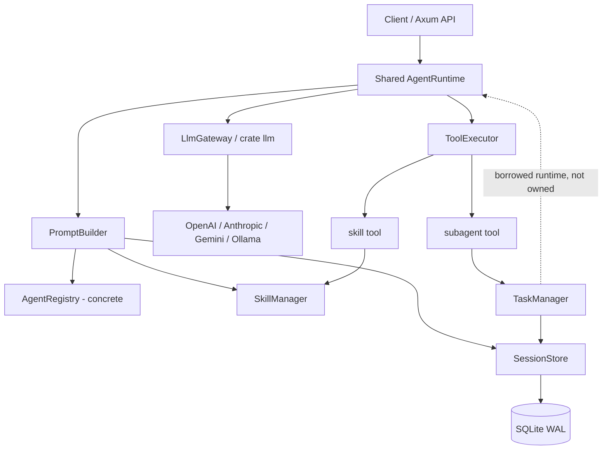

# 01 — Kiến trúc tổng thể (MVP tinh gọn)

## 1.1. Topology



**Không có `OrchestratorEngine` riêng trong MVP.** Root là `AgentDefinition(mode=primary)` chạy qua cùng `AgentRuntime::run()` như Subagent. Parent và child **không chia sẻ history**, chỉ chia sẻ runtime, modules và storage.

## 1.2. Modules và interfaces

| Module | Interface public nhỏ | Implementation nằm bên trong |
|---|---|---|
| `AgentRuntime` | `run(session_id, input)` | Admission, LLM/tool loop, **persist transcript/run**, budgets, stop/error. |
| `PromptBuilder` | `build(session_id)` | Base + agent prompt, project instructions, skill catalog, history, tool definitions, context budget. |
| `SessionStore` | `create`, `append`, `history`, `start_run`, `finish_run` | SQLite transactions, sequencing, single-running-run invariant, recovery. |
| `ToolExecutor` | `execute(call, context)` | Validate input, permissions, dispatch, normalize/truncate result; **không persist message**. |
| `SkillManager` | `available(agent)`, `load(session, skill_id)` | Scan `skills/` lúc startup, permission, safe local file reads. |
| `TaskManager` | `delegate(request, runtime_ref)` | Check mode/ownership/depth, create/resume child, invoke child runtime, return final text. |
| `LlmGateway` | `complete(model, context)` | Adapter crate `llm`, tool protocol conversion, multi-provider capability/errors. |
| `AgentRegistry` | `get`, `list` | Concrete struct load YAML một lần lúc startup; chưa có trait/hot reload. |

`TaskManager` chỉ được giữ nếu che giấu toàn bộ **delegation lifecycle**, không phải lớp chuyển tiếp mỏng. `LlmGateway` là seam có giá trị vì protocol và fake LLM thực sự khác nhau; không tạo thêm wrapper/provider traits khi chưa cần.

## 1.3. Ownership và dependency rules

- **`AgentRuntime` là nơi duy nhất điều phối việc ghi user/assistant/tool-call/tool-result vào transcript** qua `SessionStore`. `ToolExecutor` chỉ trả `ToolOutcome`.
- `TaskManager` sở hữu logic tạo/tiếp tục child và chờ child; liên kết `child_session_id` với tool invocation thông qua `SessionStore`. Nó **không** ghi bản sao output vào bảng `tasks`.
- `ToolExecutor` gọi `TaskManager` cho `subagent`; chuyển borrowed `&AgentRuntime` ở execution time để tránh vòng sở hữu `Arc`. Nếu compiler yêu cầu do async recursion, box future **tại nhánh child invocation**, không thiết kế một tầng abstraction mới.
- `PromptBuilder` là owner duy nhất của context construction; **không tạo `ContextManager` thứ hai**.
- Không giữ transaction SQLite trong lúc đợi provider, child run hoặc tool I/O.
- Tool/Skill/Prompt không tự thay đổi permissions hoặc đánh giá ngữ nghĩa của child final text.

## 1.4. Rust source tree tối thiểu

```text
src/
├── main.rs                 # config + Axum wiring
├── agent.rs                # AgentDefinition + concrete AgentRegistry
├── runtime.rs              # Shared AgentRuntime
├── prompt.rs               # PromptBuilder + project instructions
├── skill.rs                # SkillManager + skill tool implementation
├── tool.rs                 # ToolExecutor + tool types
├── subagent.rs             # TaskManager + subagent tool
├── session.rs              # SessionStore + session/run types
├── llm.rs                  # LlmGateway + protocol mapping
└── api.rs                  # minimal routes
config/agents.yaml
prompts/{base.md,root.md,reviewer.md}
skills/<name>/SKILL.md
migrations/001_init.sql
```

Khởi đầu **một Cargo package**. Tách file/trait/crate khi thay đổi thực tế buộc phải làm vậy; đừng đo độ sâu module bằng số dòng implementation.

## 1.5. IDs và persistence

| Identity | Mục đích |
|---|---|
| `agent_id` | Vai trò/model/permissions trong config. |
| `session_id` | Hội thoại bền vững; child có `parent_session_id`; resume qua ID. |
| `run_id` | Một execution attempt, trạng thái trong `agent_runs`. |
| `tool_call_id` | Ghép assistant tool call với tool result; mỗi lần `subagent` là một invocation. |
| `child_session_id` | Lưu trên invocation `subagent`; nhiều invocation có thể tiếp tục một child. |

**Không có bảng `tasks` riêng ở MVP**: một lần delegation được biểu diễn bằng `tool_invocations(tool_name='subagent')` thuộc parent run. `task_id` nếu cần để tracing có thể dùng `tool_invocations.id`. Xem [09 — Persistence](09-persistence.md).

## 1.6. Sau MVP

Background subagent + inbox, parallel child jobs, session compaction, artifact store, skill hot reload/multi-source và distributed workers. Không đưa interfaces chưa dùng vào đường code chính.
