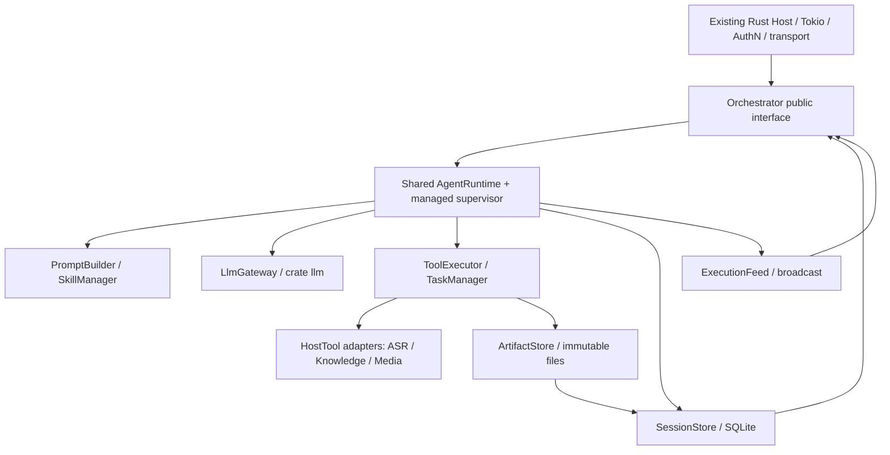

# 01 — Kiến trúc tổng thể (MVP tinh gọn)

## 1.1. Topology



Root/Child dùng chung runtime nhưng mỗi session có transcript riêng. Host không import internal AgentRuntime/SQLite/Axum types; core không phụ thuộc HTTP. Không có business task scheduler hay OrchestratorEngine thứ hai.

## 1.2. Modules và interfaces

| Module | Interface | Implementation / ownership |
|---|---|---|
| `Orchestrator` (public) | `create_session/submit/result/history/list_artifacts/open_artifact/snapshot/subscribe/cancel/shutdown` | Trusted scope, lifecycle và result projection; nội bộ bị ẩn. |
| `HostTool` (public seam) | `descriptor/execute(ToolContext,args)` | Host implements ASR/Knowledge/media; tool không direct SQL/filesystem. |
| `AgentRuntime` (internal) | run/continuation loop | One transcript writer và execution ordering/recovery. |
| `SessionStore` (internal) | atomic admission/commits/reads | SQLite child-turn lineage, final-message lineage, checkpoint CAS. |
| `ArtifactStore` (internal) | put/open/list | Immutable publication, authorized reads và integrity. |
| `TaskManager` (internal) | delegate | Atomic idempotent child admission, await đúng child turn. |
| `PromptBuilder/SkillManager` (internal) | build/available/load | Embedded base prompt, effective session permissions, compaction. |
| `LlmGateway` (internal) | stream | Typed host config, multi-provider call normalization. |
| `ExecutionFeed` (internal) | publish/subscribe | Tokio broadcast; canonical state từ SessionStore. |

Đặt seam nơi adapter thực sự thay đổi, không tạo trait SkillStore/ArtifactAccessProvider chỉ để fake.

## 1.3. Ownership và dependency rules

- **`AgentRuntime` là nơi duy nhất điều phối việc ghi user/assistant/tool-call/tool-result/synthetic/compaction vào transcript** qua `SessionStore`. `ToolExecutor` chỉ trả `ToolOutcome`.
- **Commit trước, publish committed event sau:** SQLite `state_revision` tăng trong transaction, rồi EventFeed phát lifecycle event. Progress/delta realtime không phải canonical state; `ToolContext.progress` gửi qua reporter thay vì Tool import SSE/EventBus.
- `ExecutionFeed` là concrete Tokio broadcast; host transport adapter chịu auth/filter/heartbeat/lag signal, còn `SessionStore.family_snapshot` cung cấp canonical state. Committed notifications **chỉ invalidate snapshot**; text/tool progress vẫn live ephemeral.
- `TaskManager` sở hữu logic tạo/tiếp tục child và chờ child qua `AgentRuntime.submit` + `wait`; atomically liên kết `child_session_id`/`child_turn_id` với parent invocation và child run admission trong `SessionStore`. Nó **không** ghi bản sao output vào bảng `tasks`.
- `ToolExecutor` gọi `TaskManager` cho `subagent`; chuyển borrowed `&AgentRuntime` ở execution time để tránh vòng sở hữu `Arc`. Nếu compiler yêu cầu do async recursion, box future **tại nhánh child invocation**, không thiết kế một tầng abstraction mới.
- `PromptBuilder` là owner duy nhất của context construction; **không tạo `ContextManager` thứ hai**.
- Không giữ transaction SQLite trong lúc đợi provider, child run hoặc tool I/O.
- Tool/Skill/Prompt không tự thay đổi permissions hoặc đánh giá ngữ nghĩa của child final text.

## 1.4. Rust source tree tối thiểu

```text
src/
├── lib.rs                   # public reexports
├── orchestrator.rs          # host-facing handle/builder
├── host_tool.rs             # HostTool + scoped ToolContext
├── types.rs                 # public result/error types
└── internal/
    ├── runtime.rs           # shared runner, managed supervisor
    ├── session.rs           # SessionStore / SQLite
    ├── artifact.rs          # ArtifactStore / local filesystem
    ├── llm.rs               # LlmGateway
    ├── prompt.rs            # PromptBuilder
    ├── skill.rs             # SkillManager
    ├── tool.rs              # ToolExecutor
    ├── subagent.rs          # TaskManager
    └── events.rs            # ExecutionFeed
migrations/
examples/axum_host.rs       # optional host adapter
```

Một Cargo package với `[lib]`; typed host config điều khiển prompts/skills/provider. Mandatory runtime base prompt được embed, không yêu cầu host copy `prompts/base.md`.

## 1.5. IDs và persistence

| Identity | Mục đích |
|---|---|
| `agent_id` | Vai trò/model/permissions trong config. |
| `session_id` | Hội thoại bền vững; child có `parent_session_id`; resume qua ID. |
| `run_id` | Một execution attempt, trạng thái trong `agent_runs`. |
| `tool_call_id` | Provider ID cho call/result, scoped theo assistant message. |
| `tool_invocations.id` | Internal durable invocation primary key/idempotency identity. |
| `child_turn_id` | Turn cụ thể cho parent invocation, không đổi qua attempts. |
| `child_session_id` | Lưu trên invocation `subagent`; nhiều invocation có thể tiếp tục một child. |

**Không có bảng `tasks` riêng ở MVP**: một lần delegation được biểu diễn bằng `tool_invocations(tool_name='subagent')` thuộc parent run. `task_id` nếu cần để tracing có thể dùng `tool_invocations.id`. Xem [09 — Persistence](09-persistence.md).

## 1.6. Continuous execution

`durably admit input → run LLM/tool loop → final/cancel/error`. Một user turn có thể chạy hàng giờ; không tự cắt run vì 20/15 steps. HTTP disconnect không mặc định cancel session. Auto compaction và safe startup recovery là một phần nền tảng, không phải plugin job scheduler. Xem [15](15-long-running-sessions.md).

## 1.7. Sau MVP

Background Subagent + durable parent inbox, parallel child jobs, provider-native compaction, **lossless event replay/WebSocket**, skill hot reload/multi-source và distributed workers. SSE realtime + snapshot thuộc MVP. Xem [16](16-streaming-events.md).
