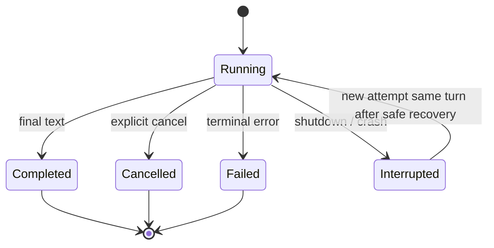

# 02 — Agent

## 2.1. Vai trò

- **Root/Primary Agent:** tiếp nhận user request, lập kế hoạch linh hoạt, gọi tools và `subagent`, đánh giá result, tổng hợp response cuối. Không bị TaskManager ép semantic validation.
- **Subagent:** nhận objective trong child session độc lập; có model/prompt/skill/tool quyền riêng; trả final assistant text.
- **AgentDefinition** là cấu hình bất biến cho một run. **AgentSession** là conversation state. **AgentRun** là execution attempt. Không gộp chúng thành một Rust struct khổng lồ.

## 2.2. Agent Definition (thiết kế)

```rust
#[derive(Debug, Clone, serde::Deserialize, serde::Serialize)]
pub enum AgentMode { Primary, Subagent, All }

#[derive(Debug, Clone, serde::Deserialize, serde::Serialize)]
pub struct AgentDefinition {
    pub id: String,
    pub mode: AgentMode,
    pub description: String,
    pub prompt_path: std::path::PathBuf,
    pub provider_id: String,
    pub model_id: String,
    pub allowed_tools: Vec<String>,
    pub allowed_skills: Vec<String>,
    pub allowed_subagents: Option<Vec<String>>, // None = all non-Primary agents; Some(list) = allowlist
    pub steps: Option<u32>, // None = no cap; Some(n>0) = text-only stop at limit
}
```

Có thể thêm model variant và per-agent overrides khi adapter thực tế hỗ trợ. `steps` là tùy chọn, validate `n > 0`; không đặt mặc định 20/15. Depth và cost/quota guardrails là runtime policy.

## 2.3. Agent Registry

```rust
pub struct AgentRegistry {
    definitions: std::collections::HashMap<String, AgentDefinition>,
}

impl AgentRegistry {
    pub fn get(&self, id: &str) -> Option<&AgentDefinition> {
        self.definitions.get(id)
    }
    pub fn list(&self) -> impl Iterator<Item = &AgentDefinition> {
        self.definitions.values()
    }
}
```

MVP dùng concrete typed `AgentRegistry` nhận `Vec<AgentDefinition>` từ host config. YAML/TOML loader là tùy chọn ở host/example, không là dependency bắt buộc của core. Không tạo registry trait một implementation.

- Host truyền typed definitions lúc build; validate unique IDs, prompt path tồn tại và model reference hợp lệ ở mức cú pháp.
- Với `docs/examples/agents.yaml`: map `agents.<key>` → `id`, `prompt/provider/model/tools/skills` → `prompt_path/provider_id/model_id/allowed_tools/allowed_skills`. Validate provider aliases và modes; không deserialize YAML example trực tiếp vào AgentDefinition.
- Root phải có mode `Primary|All`, child phải có mode `Subagent|All`. Nếu một agent cấu hình `allowed_subagents`, mọi ID trong danh sách phải tồn tại trong registry và có `mode != AgentMode::Primary` (vi phạm trả `ConfigReason::InvalidRuntimeConfig` lúc build).
- Cấu hình được load tại startup; thay đổi file cần restart. Mỗi run dùng snapshot definition đã resolve, không hot reload trong MVP.
- MVP mỗi AgentDefinition cấu hình `(provider_id, model_id)` tường minh; child dùng model riêng, không hỗ trợ model override qua tool. Model inheritance/override theo OpenCode chỉ bổ sung khi có use case và đã kiểm chứng adapter.

## 2.4. Run lifecycle và stop semantics



Một run có thể gồm hàng trăm model/tool steps trong một turn. `steps=None` không đặt cap. Nếu cấu hình `steps=n`, runtime thêm max-steps guidance, đặt `tool_choice=none` rồi trả **text-only progress report** (không auto-spawn run mới). `Completed` nghĩa execution final, không phải tiêu chí nghiệp vụ đã đạt. Xem [15](15-long-running-sessions.md).

## 2.5. Invariants

- Session có đúng một agent đang được chọn tại một thời điểm.
- Không cho nhiều `AgentRuntime.run` đồng thời trên cùng session.
- Không cho child vượt `max_subagent_depth` và quyền `subagent` theo parent.
- User instructions/skill content **không thể** tự cấp thêm quyền hoặc chỉnh runtime budgets.
- `session_id` resume phải thuộc đúng parent và quyền hiện tại; không tiếp tục session của người khác.
- Tool calls do Subagent thực hiện được kiểm tra bằng **permissions của chính child**.

## 2.6. Ví dụ

Root giao `reviewer` đọc source. Reviewer có quyền `read_file`, `skill`, không có quyền `write_file`. Nếu reviewer yêu cầu write, ToolExecutor từ chối kỹ thuật; Root nhận result/error và tự quyết định.

## 2.7. OpenCode reference

- Agent schema: https://github.com/anomalyco/opencode/blob/dev/packages/schema/src/agent.ts
- Subagent tool: https://github.com/anomalyco/opencode/blob/dev/packages/core/src/tool/plugin/subagent.ts
