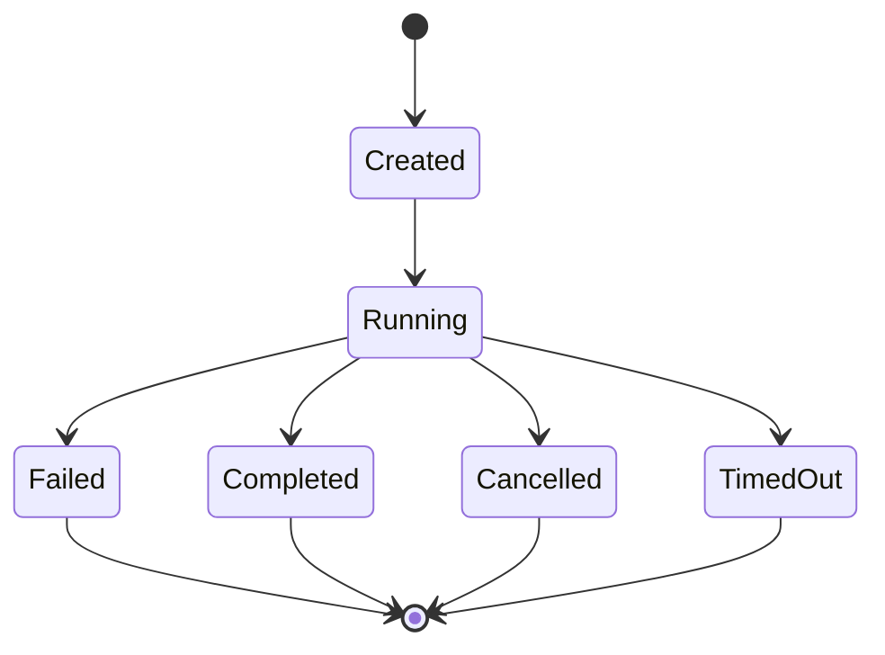

# 02 — Agent

## 2.1. Vai trò

- **Root/Primary Agent:** tiếp nhận user request, lập kế hoạch linh hoạt, gọi tools và `subagent`, đánh giá result, tổng hợp response cuối. Không bị TaskManager ép semantic validation.
- **Subagent:** nhận objective trong child session độc lập; có model/prompt/skill/tool quyền riêng; trả final assistant text.
- **AgentDefinition** là cấu hình bất biến cho một run. **AgentSession** là conversation state. **AgentRun** là execution attempt. Không gộp chúng thành một Rust struct khổng lồ.

## 2.2. Agent Definition (thiết kế)

```rust
#[derive(Debug, Clone, serde::Deserialize, serde::Serialize)]
pub enum AgentMode { Primary, Subagent, All }

#[derive(Debug, Clone, serde::Deserialize, serde::Serialize)]
pub struct AgentDefinition {
    pub id: String,
    pub mode: AgentMode,
    pub description: String,
    pub prompt_path: std::path::PathBuf,
    pub provider_id: String,
    pub model_id: String,
    pub allowed_tools: Vec<String>,
    pub allowed_skills: Vec<String>,
    pub max_steps: u32,
}
```

Có thể thêm model variant và per-agent overrides khi adapter thực tế hỗ trợ. `max_depth`, `max_tasks_per_run` và session budget thuộc orchestration policy, không nhất thiết trong mỗi AgentDefinition.

## 2.3. Agent Registry

```rust
pub struct AgentRegistry {
    definitions: std::collections::HashMap<String, AgentDefinition>,
}

impl AgentRegistry {
    pub fn get(&self, id: &str) -> Option<&AgentDefinition> {
        self.definitions.get(id)
    }
    pub fn list(&self) -> impl Iterator<Item = &AgentDefinition> {
        self.definitions.values()
    }
}
```

MVP chỉ có YAML-backed registry. Không tạo trait với một implementation; fake model/tool có thể được cấp ở các seam khác khi test.

- Load YAML lúc startup, validate unique IDs, prompt path tồn tại và model reference hợp lệ ở mức cú pháp.
- Root phải có mode `Primary|All`, child phải có mode `Subagent|All`.
- Cấu hình được load tại startup; thay đổi file cần restart. Mỗi run dùng snapshot definition đã resolve, không hot reload trong MVP.
- MVP mỗi AgentDefinition cấu hình `(provider_id, model_id)` tường minh; child dùng model riêng, không hỗ trợ model override qua tool. Model inheritance/override theo OpenCode chỉ bổ sung khi có use case và đã kiểm chứng adapter.

## 2.4. Run lifecycle



`Completed` là **hoàn thành execution**, không đảm bảo đúng nghiệp vụ. Root đánh giá `output` sau đó mới quyết định hành động tiếp.

## 2.5. Invariants

- Session có đúng một agent đang được chọn tại một thời điểm.
- Không cho nhiều `AgentRuntime.run` đồng thời trên cùng session.
- Không cho child vượt `max_subagent_depth` và quyền `subagent` theo parent.
- User instructions/skill content **không thể** tự cấp thêm quyền hoặc chỉnh runtime budgets.
- `session_id` resume phải thuộc đúng parent và quyền hiện tại; không tiếp tục session của người khác.
- Tool calls do Subagent thực hiện được kiểm tra bằng **permissions của chính child**.

## 2.6. Ví dụ

Root giao `reviewer` đọc source. Reviewer có quyền `read_file`, `skill`, không có quyền `write_file`. Nếu reviewer yêu cầu write, ToolExecutor từ chối kỹ thuật; Root nhận result/error và tự quyết định.

## 2.7. OpenCode reference

- Agent schema: https://github.com/anomalyco/opencode/blob/dev/packages/schema/src/agent.ts
- Subagent tool: https://github.com/anomalyco/opencode/blob/dev/packages/core/src/tool/plugin/subagent.ts
