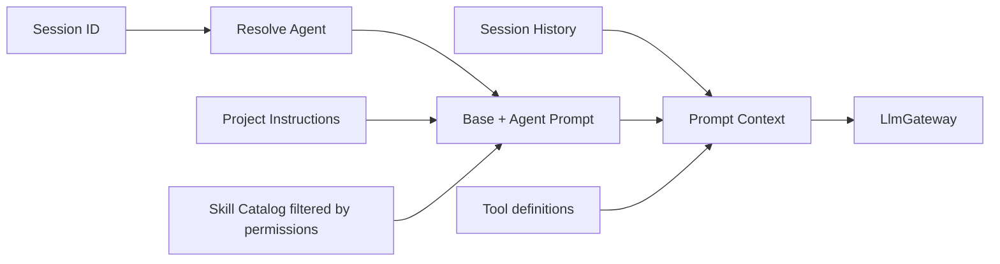

# 03 — Prompt & Instruction Management

## 3.1. Mục đích

Mỗi model request được xây từ một context có thể giải thích và tái dựng. PromptBuilder chịu trách nhiệm tập hợp các thành phần; LlmGateway chỉ chuyển đổi sang request tương thích provider.

## 3.2. Các nguồn dữ liệu

| Nguồn | Mức độ | Nội dung |
|---|---|---|
| Runtime Base | Hệ thống | Agent là ai, nguyên tắc tool/delegation, an toàn. |
| Agent Prompt | Hệ thống | Root/explorer/reviewer role và phương thức làm việc. |
| Project Instructions | Hướng dẫn workspace | `AGENTS.md`, conventions, repo-specific rules. |
| Skill Catalog | Catalog | `id`, `name`, `description` các skill được phép. |
| Session History | Hội thoại | User, assistant, tool calls/results, skill-loaded content. |
| Current User/Child Task | User/delegation message | Objective hiện tại và dữ liệu liên quan. |

**Quyết định của dự án:** tự compose base + agent prompt theo thứ tự ổn định. **Khác biệt so với OpenCode**: ở OpenCode, `agent.system` nếu tồn tại thay thế base default system prompt; chúng ta cố ý giữ base mandatory để nhất quán tool/permission guidance. Việc nhắc prompt priority không thay cho kiểm soát quyền trong code.

## 3.3. Prompt construction



Hạn chế nhồi tất cả SKILL.md vào system prompt. Tool `skill(id)` là cách nạp nội dung sâu theo yêu cầu.

## 3.4. Interface

```rust
pub struct PromptContext {
    pub system_parts: Vec<String>,
    pub messages: Vec<ModelMessage>,
    pub enabled_tools: Vec<ToolDefinition>,
}

pub struct PromptBuilder { /* dependencies injected */ }

impl PromptBuilder {
    pub async fn build(&self, session_id: &str) -> Result<PromptContext, PromptError> {
        todo!()
    }
}
```

`ModelMessage`, `ToolDefinition` là kiểu nội bộ, không phụ thuộc trực tiếp vào kiểu cụ thể của crate `llm`. Adapter đảm trách conversion.

## 3.5. Load project instructions

- MVP load `AGENTS.md` ở project root; có thể mở rộng hierarchy thư mục sau.
- Ghi `path`, content hash và revision vào metadata của request nếu cần debug/replay.
- Instructions/project files có thể thay đổi, nhưng active run nên dùng snapshot ổn định.
- Không xem văn bản repo như system authority cao hơn runtime code policy. Bất kỳ chỉ dẫn nào yêu cầu bypass permissions đều bị từ chối.

## 3.6. Prompt của Root vs Subagent

- Root: có `subagent` tool và nguyên tắc đánh giá kết quả.
- Child: nhận prompt chuyên môn của agent, task objective được gửi như user/delegation message, cùng project instructions và filtered skill catalog.
- Không tự chuyển Root history, loaded skills hoặc internal reasoning sang child. Root phải cung cấp context liên quan trong `prompt` hoặc artifact references.
- Resume child: giữ history trước đó rồi append prompt follow-up, không replace system prompt trừ khi bắt đầu một run mới với cấu hình mới đã được chủ ý phê duyệt.

## 3.7. Context size (MVP)

PromptBuilder dự trữ output budget và ước lượng message + tool schema tokens. Khi vượt giới hạn model, **trả context-limit error rõ ràng và có thể khôi phục**, không tự tóm tắt/xóa history trong MVP. Không gửi tool call thiếu tool result tương ứng vào provider. Root/User có thể mở session mới hoặc rút gọn yêu cầu theo quyết định của họ.

Compaction tự động với durable summary, lineage và khả năng nạp lại skills chỉ là phần mở rộng sau MVP; nó không thuộc interface hiện tại.

## 3.8. OpenCode reference

- https://github.com/anomalyco/opencode/blob/dev/packages/core/src/session/model-request.ts
- https://github.com/anomalyco/opencode/blob/dev/packages/core/src/session/context.ts
- https://github.com/anomalyco/opencode/blob/dev/packages/core/src/session/system-prompt.ts
