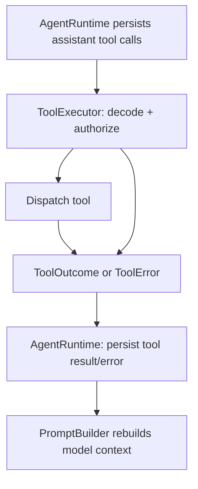

# 05 — Tools & Execution

## 5.1. Vai trò

LLM đề xuất tool call; **ToolExecutor** kiểm tra input, policy, dispatch và trả `ToolOutcome` (kết quả/lỗi). **AgentRuntime** chịu trách nhiệm ghi assistant tool calls và tool results/errors vào `SessionStore` theo thứ tự. Không có hai module cùng persist transcript.

## 5.2. Các nhóm tool

| Nhóm | Ví dụ | Chính sách |
|---|---|---|
| Read-only | `read_file`, `search_code` | Workspace path confinement, read limits. |
| Mutating | `write_file`, `edit_file`, `shell` | Permission + confirmation/idempotency rules. |
| Knowledge | `skill(id)` | SkillManager, permission, safe local SKILL.md read. |
| Orchestration | `subagent(...)` | TaskManager, owner/depth/budget checks. |
| External | HTTP/MCP (sau MVP) | Không đưa vào MVP. |

## 5.3. Interface nội bộ

```rust
#[derive(Debug, Clone)]
pub struct ToolCall {
    pub id: String, // provider tool-call ID, scoped to an assistant message
    pub name: String,
    pub args: serde_json::Value,
}

// Canonical scoped public ToolContext is specified in docs/18 §18.6.2.
// ToolExecutor uses runtime-created trusted ToolContext, not a second shape.

pub struct ToolOutcome {
    pub call_id: String,
    pub content: String,
    pub metadata: serde_json::Value,
}

pub struct ToolExecutor { /* concrete registry + policy */ }

impl ToolExecutor {
    pub async fn execute(&self, call: &ToolCall, context: &ToolContext, runtime: &AgentRuntime)
        -> Result<ToolOutcome, ToolError>
    {
        todo!()
    }
}
```

Ví dụ chỉ nêu **interface dự kiến**, không phải Rust code đã compile. `runtime` là borrowed handle từ call site, chỉ nhánh `subagent` sử dụng để chạy child; không tạo cyclic ownership. Tool execution chỉ bắt đầu **sau khi toàn provider response đã kết thúc thành công**, đầy đủ các tool calls của assistant message đã được persist. Calls trong một response được execute tuần tự trong MVP, sau đó mới mở next model step. Chi tiết thứ tự stream tại [16](16-streaming-events.md).

## 5.4. Execution & transcript ownership



- Lưu assistant message có tool calls và `tool_invocations.status=requested` **trước khi thực hiện side effect**. Internal `tool_invocations.id` là stable invocation key; provider `tool_call_id` được giữ nguyên cho model history và unique trong từng assistant message (không yêu cầu unique toàn session). Tool-result message gắn `messages.tool_invocation_id` để replay/reconciliation không suy đoán pairing bằng provider ID toàn session. ToolExecutor không mở transcript transaction riêng.
- Sau khi tool trả: runtime ghi tool result/error và cập nhật invocation `completed/failed` **trong cùng transaction**. Luôn bảo toàn `tool_call_id`.
- **Events:** `tool.started` chỉ emit sau invocation requested/running được persist. `ToolContext::progress(..)` emit ephemeral `tool.progress` không ghi SQLite. Runtime publish terminal tool event **sau commit** result/error; không publish terminal success nếu DB commit thất bại.
- Technical schema checks chỉ kiểm tra input/output envelope. `subagent.output` là text string; không buộc JSON nghiệp vụ.
- **Không cam kết exactly-once cho side effects.** Sau crash giữa thực thi và xác nhận, outcome có thể **unknown**. Đánh dấu `interrupted`, không auto-replay; cần xác minh thủ công hoặc thao tác idempotent trước khi thực thi lại.
- Khi restart gặp pending invocation chưa có confirmed result: tuyệt đối không gửi dangling call/result pair vào LLM. Read-only/idempotent tool có thể reconcile theo policy; mutating tool với outcome unknown thì **block execution** cho tới khi xác minh. Sau reconciliation an toàn, session có thể resume nếu còn recovery budget.

## 5.5. Large outputs / ArtifactStore (MVP)

Model-visible `ToolOutcome.content` có byte/line cap. `tool_invocations.result_json` chỉ chứa bounded text/metadata; raw output vượt hard persistence cap đi qua local immutable `ArtifactStore`. HostTool dùng trusted `ToolContext.artifacts().put/open` để tạo/đọc refs theo effective permissions, owner/workspace/ancestry, integrity và streaming limits, không direct SQL/filesystem. Durable manifests commit qua `SessionStore` checkpoint pointer CAS của internal `invocation_id`, không tạo bảng checkpoints. Xem [17](17-agent-results-artifacts.md), [18](18-embeddable-library.md).

## 5.6. Prompt injection

Tool output, repository files, skill instructions và subagent final text là **untrusted context**. Runtime policy được thực thi trong Rust, không phụ thuộc model tuân thủ văn bản.

## 5.7. OpenCode reference

- https://github.com/anomalyco/opencode/blob/dev/packages/core/src/tool/runtime.ts
- https://github.com/anomalyco/opencode/blob/dev/packages/core/src/tool-output.ts

## 5.8. Tool streaming & progress (MVP)

`ToolExecutor.execute` không nhận SSE/WebSocket client. `ToolContext::progress(update)` che giấu sender do runtime inject; dùng được ở `read_file`, `run_tests`, `subagent`, `skill` mà không tạo thêm trait/struct public. Trạng thái terminal cuối cùng được dựng từ `tool_invocations` + confirmed `messages`; progress preview có thể mất khi reconnect. Tool invocation không được bắt đầu trước durable request. Đối với `outcome_unknown`, recovery đánh dấu interrupted, **không** giả kết quả rồi retry. Xem [16 — Streaming](16-streaming-events.md).
