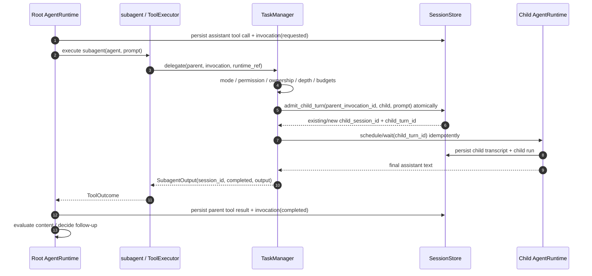

# 06 — Giao tiếp Root ↔ Subagent (OpenCode-style, foreground MVP)

## 6.1. Quyết định

Root gọi **tool `subagent`**, `TaskManager` tạo hoặc tiếp tục child session, chạy bằng cùng `AgentRuntime` và trả **final assistant text** dưới dạng tool result cùng `session_id`. Root đánh giá kết quả; không ép JSON nghiệp vụ hoặc tự chạy semantic validator/auto-retry.

**Completed chỉ là trạng thái thực thi, không xác nhận chất lượng công việc.**

## 6.2. Input/output envelope

```rust
#[derive(Debug, serde::Deserialize)]
pub struct SubagentInput {
    pub agent: String,
    pub description: String,
    pub prompt: String,
    pub session_id: Option<String>, // None => new child; Some => resume
}

#[derive(Debug, serde::Serialize)]
pub struct SubagentOutput {
    pub session_id: String,
    pub status: String, // always "completed" on successful foreground execution
    pub output: String, // free-form final text, no business JSON contract
}
```

`SubagentOutput` là **envelope do runtime tạo**, không do child LLM viết. Lỗi quyền, timeout **của LLM/tool operation**, model và cancellation được trả qua ToolError, có child session ID nếu đã tạo. Không có deadline tổng cho child. **Không có `background` input hay `running` output trong schema MVP**; tránh quảng cáo một tính năng chưa hỗ trợ.

## 6.3. Foreground delegation



- **AgentRuntime** persist parent tool result; TaskManager không tự ghi result trùng vào `tasks` table.
- `SessionStore.admit_child_turn` là một transaction ngắn: verify ownership, append child input, claim child run và persist `child_session_id/child_turn_id` trên parent invocation. `tool_invocations.id` là idempotency key; repeated call cho same invocation trả existing turn, không submit trùng. Không await child LLM trong transaction.
- Vì Child cũng chạy `AgentRuntime`, recursive async invocation có thể cần boxed future tại nhánh delegation. TaskManager không sở hữu `Arc<AgentRuntime>` để tránh strong-reference cycle.

### Nội dung model nhìn thấy

```xml
<subagent sessionID="ses_child" state="completed">
Found 3 candidate issues; see src/auth.rs ...
</subagent>
```

Không yêu cầu `findings` / `evidence` ở dạng JSON. Root tự quyết định xem văn bản đã đủ chưa.

## 6.4. Resume child session

Ví dụ gọi tiếp:

```json
{ "agent": "reviewer", "session_id": "ses_child", "description": "Verify evidence", "prompt": "Provide file references for each issue." }
```

TaskManager phải xác nhận child tồn tại, `child.parent_session_id == caller.session_id`, đúng owner/workspace, phù hợp agent policy và không có active run khác trên child session. Nếu busy, MVP trả ToolError; không queue/steer. Mỗi lần gọi `subagent` sinh **một parent invocation mới**, có thể liên kết cùng `child_session_id` nhưng phải liên kết **child_turn_id mới**. Two identical prompt texts trong hai invocations không phải cùng logical turn.

## 6.5. Root đánh giá kết quả

Nếu text đầy đủ, Root sử dụng. Nếu thiếu thông tin/sai yêu cầu, Root gọi lại `subagent(session_id, followup)` trong child cũ, hoặc dùng tool/agent khác để kiểm chứng. Hệ thống không tự sinh `TaskContract` hoặc tự repair JSON.

Nếu child hoàn thành nhưng không có text, dùng `"Subagent completed without a text response."`, giữ metadata `empty_text=true`; Root quyết định xử lý.

## 6.6. Tool errors

| Error code | Nguyên nhân | Hành vi |
|---|---|---|
| `AGENT_NOT_FOUND` / `MODE_DENIED` | Target agent invalid | ToolError, không tạo child. |
| `PERMISSION_DENIED` / `DEPTH_LIMIT` | Policy chặn | ToolError, không tạo child. |
| `SESSION_NOT_CHILD` / `SESSION_BUSY` | Resume sai parent/child đang chạy | ToolError. |
| `MODEL_UNAVAILABLE` | Lỗi model/credential | ToolError được sanitize. |
| `PROVIDER_TIMEOUT` / `TOOL_TIMEOUT` / `CHILD_CANCELLED` | Timeout theo từng request/tool hoặc explicit cancel | Không áp overall child deadline 120 giây; child có thể chạy hàng giờ. |
| `CHILD_FAILED` | Runtime/provider error | ToolError kèm child session ID nếu có. |

Không lộ secrets trong error. Việc Root retry là **quyết định của Root**, không là runtime-loop tự động.

## 6.7. Sau MVP

Background (`background=true`), output `running`, durable synthetic notification/inbox và parallel children sẽ được thiết kế cùng nhau khi có yêu cầu; không triển khai pipeline nửa vời từ MVP.

## 6.8. OpenCode references

- https://github.com/anomalyco/opencode/blob/dev/packages/core/src/tool/plugin/subagent.ts
- https://github.com/anomalyco/opencode/blob/dev/packages/core/src/session/subagent-job.ts
- https://github.com/anomalyco/opencode/blob/dev/packages/core/src/session/subagent-completion.ts

## 6.9. Subagent chạy hàng giờ

`TaskManager.delegate` foreground chờ child session execution hoàn thành, không dùng `child_timeout_s` cho toàn chuỗi. Child có thể thực hiện nhiều model/tool steps và auto compaction trước khi trả final text. Client HTTP disconnect **không** tự cancel parent; explicit cancel propagate parent → child. Sau restart, parent chỉ wait/result của persisted `child_turn_id` của invocation; child recovery giữ turn và có thể có new run attempts. Child phải recover/reconcile an toàn trước khi parent nhận final. Nếu `steps` được cấu hình trên child, report tại cap chỉ là execution outcome; Root vẫn tự đánh giá và có thể follow-up cùng `session_id`. Xem [15](15-long-running-sessions.md).

## 6.10. Live child observation

Foreground Root await child nhưng family SSE vẫn thấy child `run/step/text/tool` events. `subagent` và `skill` không cần custom lifecycle events: dùng `tool_name`, child session link và `session.changed` để invalidate snapshot. Parent `tool.completed` chỉ sau child final và parent result commit. Chi tiết protocol ở [16 — Streaming](16-streaming-events.md).
