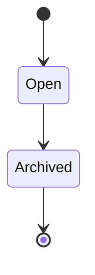

# 07 — Sessions, Runs & Context

## 7.1. Khái niệm

| Identity | Mục đích | Lưu trữ |
|---|---|---|
| `session_id` | Hội thoại bền vững, có `parent_session_id`, có thể resume nhiều lần | `sessions` |
| `run_id` | Một execution attempt gồm nhiều LLM/tool steps | `agent_runs` |
| `turn_id` | User/delegation input identity, giữ nguyên khi restart recovery | `agent_runs.turn_id` |
| `tool_call_id` | Pair tool call/result trong một session | `tool_invocations` + `messages` |
| `child_session_id` | Child được gắn với một `subagent` tool invocation | `tool_invocations.child_session_id` |

Không có bảng `tasks` riêng ở MVP. `Session` không đồng nghĩa `Run`; child có thể có nhiều lượt run nối tiếp.

## 7.2. Parent–child hierarchy

```text
ses_root (agent=root, parent=NULL)
  ├── ses_explore (agent=explore, parent=ses_root)
  └── ses_review  (agent=reviewer, parent=ses_root)
```

Child không tự kế thừa toàn bộ parent history/loaded skill content. Root phải đưa các thông tin liên quan vào prompt khi delegate.

## 7.3. Session lifecycle



**Session status chỉ `open` hoặc `archived`** để tránh lưu trùng running state. **Run status** là `running/completed/failed/cancelled/timed_out/interrupted`. Session lỗi run vẫn có thể `open` và resume; archived không nhận run mới. Có thể truy vấn một session đang thực thi qua `agent_runs.status='running'`.

## 7.4. Message model

- `messages` ghi user, assistant, tool result với `content_json`, `sequence`; assistant tool calls thuộc assistant content và có `tool_call_id` khớp tool result.
- `next_sequence` được reserve atomically; `UNIQUE(session_id, sequence)` bảo đảm thứ tự.
- `AgentRuntime` là owner duy nhất ghi transcript; `ToolExecutor` và `TaskManager` không ghi messages thay runtime.
- Trước khi gọi LLM, không để dangling tool call/result pair còn `requested/running/interrupted` mà chưa reconcile.

## 7.5. Single active run / session

`SessionStore.start_run()` thực hiện SQLite `INSERT INTO agent_runs(status='running')` trong transaction ngắn. **Unique partial index** `(session_id) WHERE status='running'` quyết định admission; khi xung đột trả `SESSION_BUSY` thay vì đợi khóa ngầm. Không cần `sessions.active_run_id` hoặc per-session Tokio mutex thứ hai ở MVP.

Khi run hoàn thành, `finish_run()` persist final text + terminal status. **Safe restart recovery**: scan stale `agent_runs.running`; nếu không có ambiguous mutating tools, mark attempt cũ `interrupted`, thêm attempt mới cùng `turn_id` + `resume_attempt` tăng và continuation marker, rồi tiếp tục session. Nếu tool outcome unknown thì block để reconcile, không tự replay side effects. Startup recovery chỉ khi previous instance đã ngừng.

## 7.6. Context construction

Chỉ **PromptBuilder.build(session_id)** tạo model context (base + agent + project instructions, skills catalog, history, available tools). Không tạo `ContextManager` riêng. Skill content đã load xuất hiện nhờ tool result trong history cùng session.

## 7.7. Continuous execution, context checkpoint và HTTP lifecycle

User turn có thể chạy nhiều giờ; `steps` không đặt mặc định. API persist input + active execution claim rồi có thể trả `202 Accepted`; managed Tokio runtime tiếp tục độc lập với HTTP disconnect. Tại context threshold, **automatic summary compaction** tạo message `role='compaction'` với `summary`, `keep_from_sequence`, `version`, rồi `PromptBuilder` dựng lại model context; original transcript vẫn ở SQLite. Không cắt giữa tool call và result, không tự bịa outcome missing. Có thể load lại skill sau compaction. Xem [15](15-long-running-sessions.md).

## 7.8. Ownership

`parent_session_id` cố định; mọi resume phải kiểm tra đúng parent, owner/workspace và permissions hiện tại. Một shared Rust process không có nghĩa nhiều users/sessions mặc nhiên tin cậy nhau.

## 7.9. Session-family revision và reconnect

`sessions.state_revision` tăng khi committed UI state đổi, độc lập với message sequence. `SessionStore.family_snapshot(root_id)` trả canonical Root/Child view trong một SQLite read transaction. **SSE committed events chỉ làm invalidation**, không phải state patches; reconnect cần snapshot refresh. Hợp đồng đầy đủ ở [16](16-streaming-events.md).
