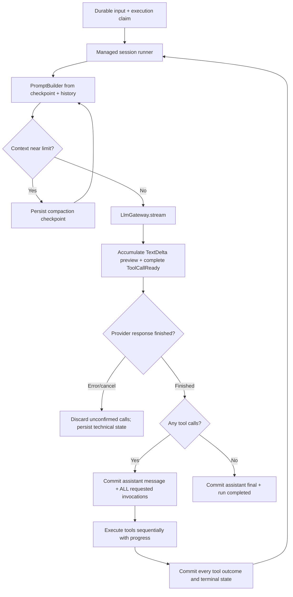

# 08 — Shared AgentRuntime & LlmGateway

## 8.1. Continuous runtime loop



**Không execute khi provider mới stream một `ToolCallReady`**: tất cả tool calls phải có arguments hợp lệ, toàn response phải kết thúc thành công và các requested invocations đã được persist. MVP dispatch tuần tự, **next LLM step chỉ bắt đầu sau khi mọi tool results đã settled**. Text deltas stream live như preview; nếu stream lỗi, không commit preview thành final. Session có thể chạy hàng giờ, không có steps cap mặc định. Thứ tự chuẩn xem [16](16-streaming-events.md).

## 8.2. Interface và HTTP-independent execution

```rust
pub struct SubmitRequest { pub session_id: String, pub text: String }
pub struct AcceptedTurn { pub session_id: String, pub turn_id: String }

pub struct RunResult { pub session_id: String, pub turn_id: String, pub final_text: String }
pub struct AgentRuntime { /* injected dependencies, managed execution */ }
impl AgentRuntime {
    pub async fn submit(&self, req: SubmitRequest) -> Result<AcceptedTurn, RuntimeError> { todo!() }
    pub async fn wait(&self, session_id: &str, turn_id: &str) -> Result<RunResult, RuntimeError> { todo!() }
    pub async fn resume(&self, session_id: &str) -> Result<(), RuntimeError> { todo!() }
    pub async fn cancel(&self, session_id: &str) -> Result<(), RuntimeError> { todo!() }
}
```

`submit` persist input và run claim **trước khi trả Accepted**; managed Tokio execution tiếp tục ngoài vòng đời của HTTP request. `AgentRuntime` sở hữu transcript writes, ToolExecutor chỉ trả outcome. Root và child dùng cùng runtime: foreground `TaskManager` gọi `submit(child, prompt)` rồi `wait(child, turn_id)` để nhận final text mà không giữ HTTP request. Child recursion được box tại call seam nếu cần. `TaskManager` không sở hữu self-referential Arc.

## 8.3. LlmGateway — seam nhỏ

```rust
pub struct ModelRef {
    pub provider_id: String,
    pub model_id: String,
}

pub struct CompletionRequest {
    pub model: ModelRef,
    pub context: PromptContext,
}

pub enum ModelEvent {
    TextDelta { message_id: String, ordinal: u64, text: String },
    ToolCallReady(ToolCall),  // only after full arguments have been assembled
    Finished { usage: Option<TokenUsage>, finish_reason: String },
}
// LlmGateway::stream(request) -> stream of Result<ModelEvent, LlmError>
// Exact Rust stream return type is selected after provider spike.
```

Adapter chuyển messages/tool calls/results sang crate `llm` và chuẩn hóa stream. `ToolCallReady` cho biết call đã assemble/validate, nhưng **không kích hoạt execution**; Runtime đợi `Finished` của toàn provider response, persist mọi calls rồi mới dispatch tuần tự. Nếu provider tool-calling chỉ hỗ trợ non-streaming, adapter có thể emit call sau full response. Test cả trường hợp provider stream lỗi sau `ToolCallReady`: không có tool side effect. Không xây provider wrapper framework lần hai.

## 8.4. Multi-provider

- `(provider_id, model_id)` là định danh model, có thể khác nhau cho parent/child.
- Key lấy từ secrets/env; không lưu vào DB/log/prompt.
- Chỉ cho phép model có tool-calling capability nếu agent dùng tools; không tự động fallback provider.
- Tool call/result ID phải được bảo toàn qua history và mapping riêng cho từng provider.

## 8.5. Tokio và resource limits

- MVP foreground: `TaskManager.delegate` await child run; **không spawn untracked tasks**. Runtime có thể box recursive future tại nhánh `subagent` để thỏa Rust async sizing.
- `CancellationToken` propagate explicit cancel parent → child; per-request LLM timeout và per-tool operation timeout. **Không có overall child/session timeout mặc định**. Không giữ SQL transaction xuyên provider latency.
- `agent.steps: Option<u32>` mặc định None. Depth=1, tool output visibility cap, optional quota/cost policy; không giới hạn tổng child calls tuần tự mặc định. Global child semaphore thêm khi triển khai concurrent children.
- Usage có thể ước lượng nếu provider không trả số liệu; ghi rõ measured/estimated.

## 8.6. Provider spike bắt buộc

Trước khi phụ thuộc sâu crate `llm`, khóa phiên bản rồi kiểm chứng với **OpenAI + một provider khác**:

1. Text completion và multi-turn history.
2. Tool call → tool result → continuation (giữ nguyên IDs).
3. Provider-specific error mapping, tool capability, timeout/cancellation.
4. **Streaming bắt buộc MVP:** text delta và tool call assembly; fallback non-streaming tool calling khi provider không hỗ trợ partial calls; test usage + error mid-stream.

Ví dụ Rust trong tài liệu là **illustrative interface**, chưa phải code đã compile.

## 8.7. Compaction, retry và recovery cho long-running execution

- Auto compaction khi context gần đầy, ghi durable `messages.role='compaction'` (summary + frontier) rồi build model context lại; original transcript không bị xóa. Khi provider từ chối vì overflow trước output, compact/retry **tối đa một lần** ở logical step.
- Optional `steps` cap (`None` theo mặc định) khiến model nhận final text-only guidance và `tool_choice=none`, báo việc còn lại; session vẫn `open`.
- Restart scan stale active claim, mark old run `interrupted`, nếu safe tạo new run cùng `turn_id`, `resume_attempt+1` (giới hạn ví dụ 10) và synthetic continuation marker. Unknown mutating tool outcome **block**, không replay.
- Session status/history theo dõi được ngay cả khi client HTTP disconnect. Background Subagent notification dành cho sau MVP.

Chi tiết: [15 — Long-running sessions](15-long-running-sessions.md).

## 8.8. ExecutionFeed & event ordering (MVP)

`AgentRuntime` phát live `text.delta`/tool progress và **committed invalidations sau SQLite commit**. `ToolContext::progress` không đi qua HTTP. SSE không giữ execution sống. `state_revision` chỉ dùng để biết cần refresh family snapshot, **không** để reducer áp state patches. Hợp đồng đầy đủ (ordering, retry, SSE, reconnect, revision) ở [16](16-streaming-events.md).
