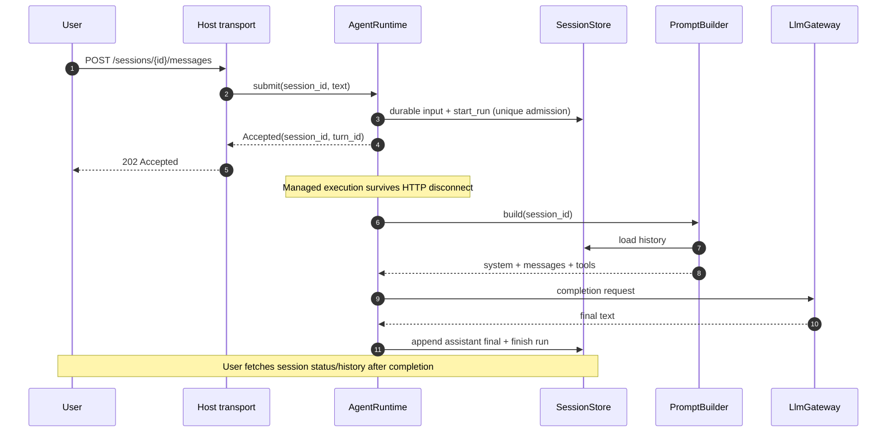
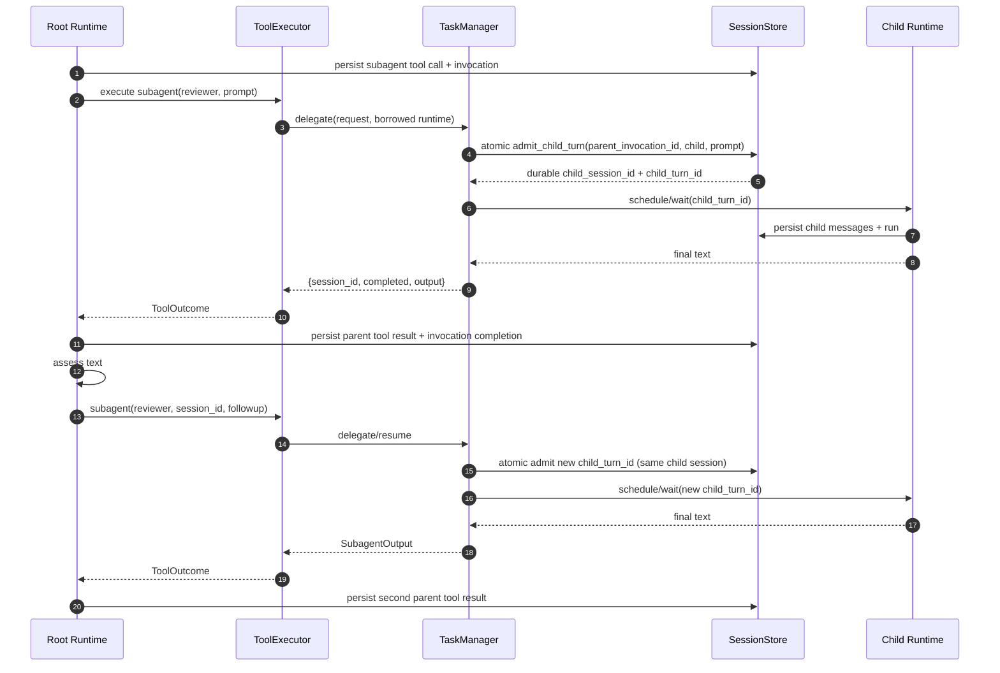
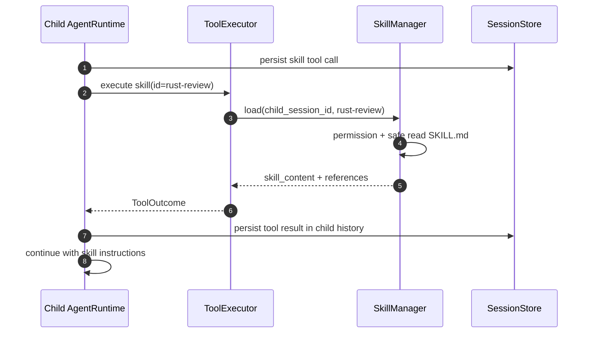

# 11 — End-to-end Flows (MVP)

## 11.1. Chat → Root → LLM



## 11.2. Root → Child → Resume (foreground)



Mỗi delegation là **một tool invocation**. Không có bảng `tasks` và không chuyển output child trực tiếp sang Root session. `AgentRuntime` là nơi ghi transcript của đúng session.

## 11.3. Skill loading during child run



## 11.4. Crash giữa side-effect tool và result

```text
Persist assistant tool call + invocation(requested)
  → execute tool (write_file/shell)
  → process crashes BEFORE durable tool result
  → startup scans stale run and pending invocation
  → mark invocation interrupted; do NOT replay / pretend succeeded
  → block for reconciliation; once safe, resume same turn in a new attempt
```

## 11.5. Errors

- Invalid tool input / permission denied → ToolError, LLM có thể sửa request nếu run vẫn còn budget.
- Child failed/provider operation timeout/cancelled → ToolError; không có tổng `child_timeout_s`, giữ child session ID nếu đã tạo.
- Child trả text sai ý → **không là runtime error**; Root có thể follow up same child session.
- Child không có text → placeholder, Root tự đánh giá.
- Context gần đầy → automatic summary compaction + bounded overflow retry; giữ full original history, trả recoverable error nếu compact thất bại.
- Incomplete side-effect call sau crash → yêu cầu reconciliation; không chạy lại mù quáng.

## 11.6. Prompt lifecycle

```text
Resolve Agent Definition + permission snapshot
  → PromptBuilder builds base/agent/project instructions
  → filter Skill Catalog metadata
  → load Session History (including previously loaded skill results)
  → attach tool definitions
  → LlmGateway converts request for chosen provider
  → Model emits final text or tool calls
  → AgentRuntime writes transcript and loops while model asks for tools
  → auto-compaction/recovery at safe boundaries; no default step cap
  → final text / explicit cancel / terminal error
```

## 11.7. Long-running + safe restart

```mermaid
sequenceDiagram
    autonumber
    participant API as Client
    participant RT as Managed AgentRuntime
    participant S as SQLite
    API->>RT: submit(session, objective)
    RT->>S: persist input + run claim
    RT-->>API: 202 Accepted
    loop Model continues requesting tools
        RT->>S: persist tool calls/results
        opt Near context limit
            RT->>S: persist compaction checkpoint
        end
    end
    Note over RT,S: Server restart may interrupt
    RT->>S: scan stale running run
    alt Safe to resume
        RT->>S: mark interrupted; create same turn new attempt
        RT->>RT: resume session runner
    else Unknown side effect
        RT->>S: mark invocation interrupted; block
    end
```

Xem [15](15-long-running-sessions.md) cho admission/stop/recovery.

## 11.8. Sau MVP

Background Subagent notification + durable parent inbox, parallel child jobs và provider-native compaction. Local ArtifactStore đã thuộc MVP. Summary compaction và restart recovery thuộc lõi MVP.

## 11.9. SSE streaming & snapshot/resync (MVP)

```mermaid
sequenceDiagram
    autonumber
    participant U as UI
    participant E as Axum SSE
    participant B as ExecutionFeed
    participant R as AgentRuntime
    participant D as SQLite
    U->>E: GET /sessions/root/events?include_children=true
    E->>B: subscribe live before snapshot
    E-->>U: stream.connected
    U->>D: GET /sessions/root/snapshot
    D-->>U: family + per-session revisions
    R->>D: persist tool requested + bump revision
    R->>B: tool.started (committed revision)
    B-->>U: tool.started
    R->>B: text.delta / tool.progress (ephemeral)
    B-->>U: text.delta / tool.progress
    R->>D: persist result + bump revision
    R->>B: tool.completed (committed revision)
    B-->>U: tool.completed
    Note over U,E: Lag/reconnect -> re-subscribe + snapshot; active runs -> periodic refresh even if connected
```

Child Tool/LLM events sử dụng session riêng nhưng cùng root family. Các committed event revisions **invalidation → debounce snapshot refresh**, không merge state patches. SQLite không lưu token fragments; SSE disconnect không điều khiển run. Xem [16](16-streaming-events.md).
