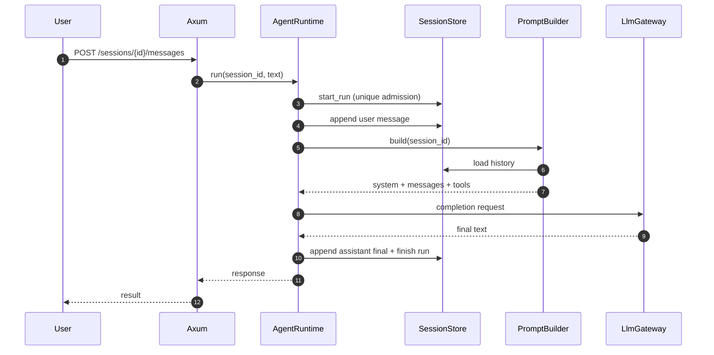
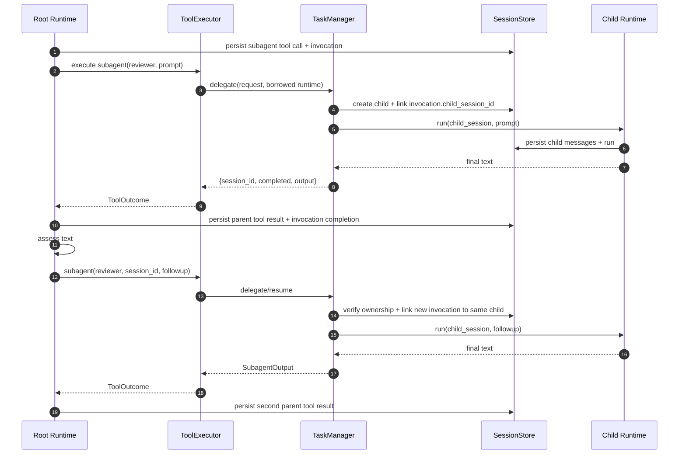
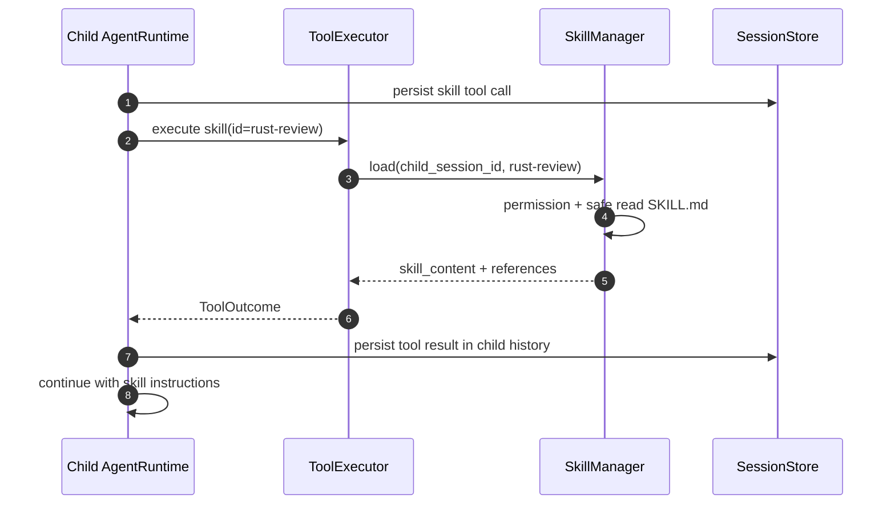

# 11 — End-to-end Flows (MVP)

## 11.1. Chat → Root → LLM



## 11.2. Root → Child → Resume (foreground)



Mỗi delegation là **một tool invocation**. Không có bảng `tasks` và không chuyển output child trực tiếp sang Root session. `AgentRuntime` là nơi ghi transcript của đúng session.

## 11.3. Skill loading during child run



## 11.4. Crash giữa side-effect tool và result

```text
Persist assistant tool call + invocation(requested)
  → execute tool (write_file/shell)
  → process crashes BEFORE durable tool result
  → startup marks run/tool invocation interrupted
  → do NOT replay / pretend succeeded
  → operator or Root/User reconciles outcome before LLM continuation
```

## 11.5. Errors

- Invalid tool input / permission denied → ToolError, LLM có thể sửa request nếu run vẫn còn budget.
- Child failed/timeout/cancelled → ToolError; giữ child session ID nếu đã tạo.
- Child trả text sai ý → **không là runtime error**; Root có thể follow up same child session.
- Child không có text → placeholder, Root tự đánh giá.
- Context vượt giới hạn → error có thể khôi phục; không tự tóm tắt/xóa lịch sử trong MVP.
- Incomplete side-effect call sau crash → yêu cầu reconciliation; không chạy lại mù quáng.

## 11.6. Prompt lifecycle

```text
Resolve Agent Definition + permission snapshot
  → PromptBuilder builds base/agent/project instructions
  → filter Skill Catalog metadata
  → load Session History (including previously loaded skill results)
  → attach tool definitions
  → LlmGateway converts request for chosen provider
  → Model emits final text or tool calls
  → AgentRuntime writes transcript and loops until finished/budget exhausted
```

## 11.7. Sau MVP

Background subagent notification + synthetic parent inbox, parallel child execution, advanced compaction and artifact store. Không có đường chạy ẩn nào cho các features này trong MVP.
