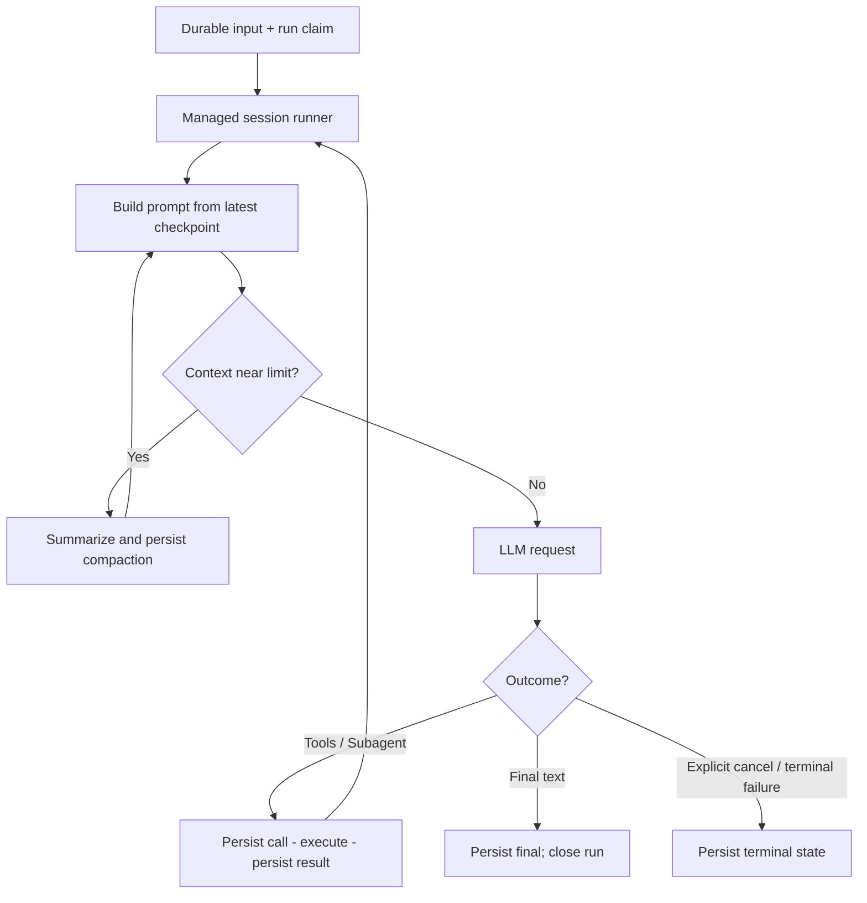
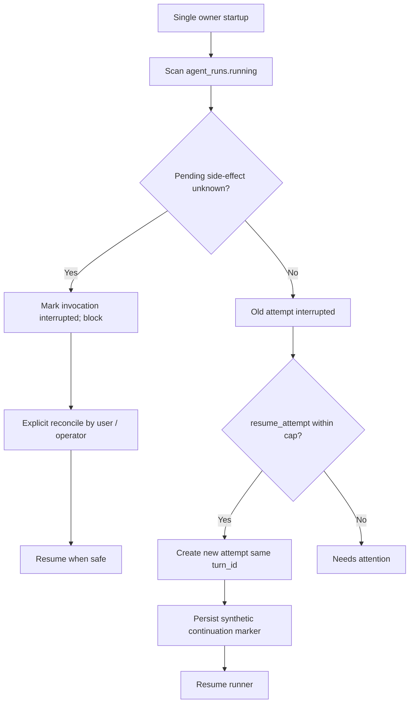

# 15 — Long-running Sessions (OpenCode-style)

**Status:** Accepted design · **Scope:** session-driven execution in Rust, not a business Task/Job scheduler.

## 15.1. Core rule

Một user request có thể kéo dài hàng giờ và dùng hàng trăm LLM calls, tool calls, skill loads và subagent delegations. **Không có step cap mặc định, không có overall child deadline**. Một managed Tokio execution loop tiếp tục trong cùng session/turn cho đến model final, explicit cancellation, terminal error hoặc policy guardrail rõ ràng. User HTTP disconnect không tự cancel execution. Root tự đánh giá chất lượng final text của child.

OpenCode cũng sử dụng optional agent `steps`, automatic compaction và bounded startup recovery. Đây là kiến trúc chúng ta sẽ triển khai, không khẳng định repository Rust đã có những tính năng này.

## 15.2. Session, Turn, Run, Step

| Identity | Định nghĩa | Persistence |
|---|---|---|
| Session | Conversation bền vững, parent/child history riêng | `sessions` |
| Turn | Một user/delegation input và recovery lineage | `agent_runs.turn_id` |
| Run | Một attempt; có thể gồm nhiều model/tool steps | `agent_runs` |
| Step | Một LLM request (+ tool calls nếu model yêu cầu) | messages / run.steps |
| Invocation | Một tool call/result pair | `tool_invocations` |
| Compaction | Model-visible summary checkpoint; full history vẫn còn | `messages.role='compaction'` |

Không tự tạo run mới chỉ để vượt `max_steps`. Run mới cùng `turn_id` chỉ khi cần recovery sau interruption.

## 15.3. Execution flow

## 15.4. HTTP-independent admission

`POST /sessions/{id}/messages` atomically persists input and `agent_runs.status='running'` claim before returning `202 Accepted(session_id,turn_id)`. Managed Tokio tasks have an owner/supervisor and are not canceled merely by client disconnect. `GET /sessions/{id}/status` and `GET /sessions/{id}/messages` provide status/history. SSE observation + Root/Child session-family snapshot are part of the MVP (see [16](16-streaming-events.md)).

One active run per session is enforced by unique partial index. Busy input returns `SESSION_BUSY` in MVP; queued/steer inbox like OpenCode can be added later. Foreground child may wait long for final text without a hard child timeout.

## 15.5. Optional step limit

`AgentDefinition.steps: Option<u32>`, **default None**. If set to positive N, on reaching N the runtime sends max-steps guidance and `tool_choice=none`, asking model to report completed and remaining work without tool calls. It is an execution stop, **not proof of business completion**, and not a technical error. Session can continue upon another user/follow-up input. Unlike a special job scheduler, the system does not spawn another run to defeat the configured step limit.

Resource guards still matter: explicit cancel, permissions, quotas/cost limits, provider rate limits, per-request timeout and tool-specific timeout. A global child timeout spanning the full delegation is intentionally absent.

## 15.6. Context compaction

Estimate token usage including instructions, tool schemas, history and output reserve. Near threshold, summarize older complete turns; append checkpoint message (`summary`, `keep_from_sequence`, `version`, `model_ref`) and build context from mandatory system + summary + recent *complete* turns. Preserve tool-call/result pairing and user objective, important decisions, evidence and artifact pointers. Keep **full original transcript** in SQLite.

If provider rejects context for length *before producing output*, auto compact and retry **once** for the logical step; if still too long, return `CONTEXT_LIMIT` recoverable. Summary is lossy. Skill can be loaded again via `skill(id)` after compaction. MVP summary via configured model; native provider compaction is future work.

## 15.7. Safe startup recovery

`agent_runs.turn_id` survives restart; `resume_attempt` increments per recovery, default recommended cap 10. This is *at-least-once recovery*, **not exactly-once execution**. For an unknown outcome of write/shell/network mutation, do not retry and do not fabricate a tool result; operator/user must reconcile. Read-only/idempotent tools may be reconciled automatically only under proven safe policy. Startup sweep assumes prior server has stopped; multi-process execution requires leases/leader election.

## 15.8. Stop semantics table

| Trigger | Behavior |
|---|---|
| Model final text | End turn, keep session open; quality assessed by Root/user |
| No `steps` configured | Continue while model asks for tools and guards permit |
| Configured `steps=N` hit | Text-only progress report, no tools, end turn |
| Context near limit | Auto compaction, continue with checkpoint |
| Provider request timed out | Bounded request retry or fail with diagnostic; does not impose global child deadline |
| Explicit user cancel | Cancel owner execution, propagate parent→child |
| HTTP disconnect | Managed run continues |
| Restart and safe transcript | Resume same turn via new run attempt, capped |
| Restart and uncertain mutation | Block for reconciliation, never blind replay |
| Recovery attempt limit exhausted | Needs attention; no infinite restart loop |

## 15.9. Scope and verification

**MVP core:** continuous loop, optional steps, durable admission, child without overall timeout, summary compaction, safe recovery and cancellation. **After MVP:** background Subagent notification/inbox, concurrent child jobs, provider-native compaction, lossless event replay and distributed scheduling. SSE text/tool progress thuộc MVP.

**Integration tests:** >100 model/tool steps no cap; configured 5-step text-only stop; child runs >120 seconds without timeout; context threshold checkpoint; provider overflow retried once; crash at safe boundary auto resume; crash with unknown write blocks; client disconnect after Accepted does not stop managed run.

## 15.10. Primary OpenCode references

- [Runner](https://github.com/anomalyco/opencode/blob/dev/packages/core/src/session/runner/llm.ts)
- [Max steps](https://github.com/anomalyco/opencode/blob/dev/packages/core/src/session/runner/max-steps.ts)
- [Agent steps docs](https://github.com/anomalyco/opencode/blob/dev/packages/web/src/content/docs/agents.mdx)
- [Compaction](https://github.com/anomalyco/opencode/blob/dev/packages/core/src/session/compaction.ts)
- [Compaction docs](https://github.com/anomalyco/opencode/blob/dev/services/www/src/docs/content/compaction.mdx)
- [Restart recovery](https://github.com/anomalyco/opencode/blob/dev/packages/core/src/session/execution/restart.ts)
- [Subagent tool](https://github.com/anomalyco/opencode/blob/dev/packages/core/src/tool/plugin/subagent.ts)

## 15.11. Quan sát task dài qua SSE

Một turn chạy nhiều giờ không phụ thuộc lifetime của SSE/HTTP. Client subscribe vào Root **session family**, quan sát child tool calls và `text.delta` ngay cả khi Root đang chờ foreground child. Tool progress và partial deltas không lưu vĩnh viễn; sau reconnect client rehydrate canonical SQLite snapshot per-session revisions. Không sử dụng SSE làm nguồn kết quả/tool replay; commit state trước publish terminal event. Xem [16](16-streaming-events.md).
