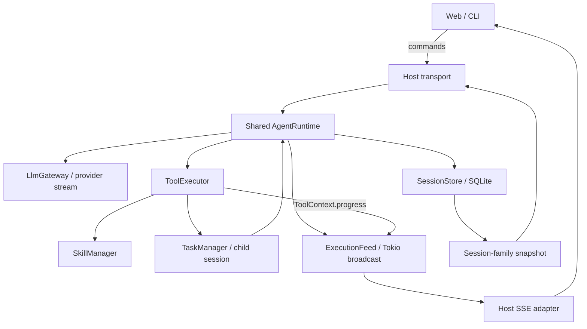
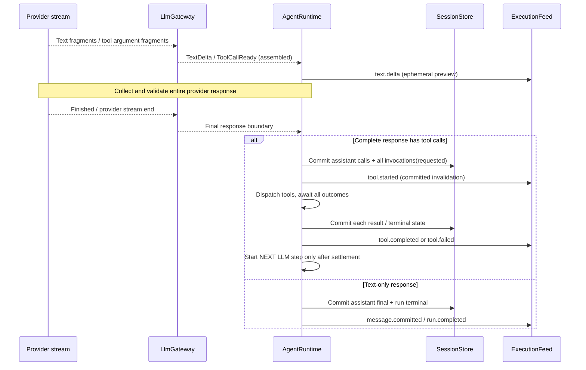

# 16 — Streaming, Execution Events & Session Family Monitoring

**Status:** Accepted design · **Version:** v5.0 (library-first) · **Scope:** MVP Rust/Tokio, transport-neutral events, host SSE adapter, SQLx/SQLite.  
**Related:** [01 Architecture](01-architecture.md), [05 Tools](05-tools.md), [06 Delegation](06-delegation.md), [07 Sessions](07-sessions-context.md), [08 Runtime](08-runtime-llm.md), [09 Persistence](09-persistence.md), [12 Tests](12-mvp-test-plan.md), [15 Long-running](15-long-running-sessions.md).

## 16.1. Decision & non-goals

Một session có thể chạy hàng giờ, gọi hàng trăm lượt LLM, tool và Subagent. **Event Streaming** là khả năng quan sát tiến trình, không phải execution driver. Kết nối HTTP/SSE bị đóng **không** ngắt managed Tokio run. SQLite là **source of truth** cho trạng thái đã commit; `tokio::sync::broadcast` chỉ fan-out event realtime.

MVP gồm: streaming text delta, run/step lifecycle, tool started/progress/terminal, skill load qua tool, liên kết Root/Child, session-family snapshot, reconnect bằng resync, permissions, cancel. MVP **không** bao gồm WebSocket, event sourcing, SSE historical replay/`Last-Event-ID`, persistent từng token, background Subagent/inbox hoặc broker. Foreground child vẫn chạy độc lập trong shared runtime và phát events trước khi trả final text cho Root.

## 16.2. Phân chia modules (Codebase Design)



| Module | Interface nhỏ | Implementation che giấu |
|---|---|---|
| `AgentRuntime` | `submit`, `wait`, `resume`, `cancel` | Provider/tool execution, transcript writes, lifecycle event publication **sau commit**, continuous loop. |
| `LlmGateway` | `stream(CompletionRequest)` | Chuyển provider fragments thành text deltas, complete tool calls, terminal usage; tool-call JSON chỉ execute khi đã hoàn chỉnh. |
| `ToolExecutor` | `execute(call, context, runtime)` | Authorize/dispatch, expose `ToolContext::progress`, return outcome. `runtime` borrowed only for subagent delegation; **không ghi transcript**. |
| `TaskManager` | `delegate(request, runtime_ref)` | Child ownership/lifecycle; session link dùng `SessionStore`, child events phát từ chính runtime. |
| `SessionStore` | `commit_*`, `family_snapshot(root)` | SQLite transactions, session revisions, child ancestry, ordered history. |
| `ExecutionFeed` | `publish(event)`, `subscribe()` | **Một concrete module**, fan-out/bounded lag policy; không tạo trait/broker framework hay truyền transport vào Tool. |
| Host SSE adapter | `GET .../events` | Auth, root-family filtering, bounded delivery, heartbeat, resync signal. |

`ExecutionFeed` là seam của domain observation → client transport, chỉ live best-effort; không persist và không quyết định semantic success. Interface `ToolExecutor::execute(&self, call, context, runtime: &AgentRuntime)` theo [05](05-tools.md) là **một hợp đồng duy nhất** trong MVP; runtime handle được borrow, không tạo vòng `Arc`.

## 16.3. Event taxonomy và durability

Phân biệt **reconstructable** (state cuối có thể dựng lại từ SQLite) với **ephemeral** (có thể mất). Các `tool.*` bao gồm **`tool_name=subagent` và `tool_name=skill`**; không phát các `subagent.started/completed` hay `skill.loaded` events trùng trạng thái. 

| Event type | Ý nghĩa | Storage/reconstruction |
|---|---|---|
| `run.started` | User/child run admitted | `agent_runs.status='running'` + session revision |
| `run.completed`, `run.failed`, `run.cancelled`, `run.interrupted` | Run terminal | `agent_runs` + revision |
| `step.started`, `step.ended` | LLM model call lifecycle/usage UI | Ephemeral; `agent_runs.steps/tokens` là snapshot tổng |
| `text.delta` | Partial assistant text của một step/message | **Ephemeral**, không lưu mỗi delta |
| `message.committed` | Full assistant message đã ghi | `messages`, gồm `sequence`, revision |
| `tool.started` | Tool invocation persisted trước side effect | `tool_invocations.requested/running` + revision |
| `tool.progress` | %/message/progress preview | **Ephemeral**, nội dung tùy Tool |
| `tool.completed`, `tool.failed`, `tool.interrupted` | Terminal / uncertain outcome | `tool_invocations` + message result khi confirmed |
| `session.changed` | Invalidation khi committed child creation/link hay state không khớp loại lifecycle chuyên biệt | Child relationship / `tool_invocations.child_session_id` + revision |
| `compaction.started` | Đang compact context | **Ephemeral** |
| `compaction.completed` | Checkpoint đã ghi | `messages.role='compaction'` + revision |
| `resync.required` | SSE subscriber đã mất event | SSE control-only; **không** phải domain event |

Committed events là **invalidation hints**, KHÔNG phải patch để reducer xây canonical state. Client dùng hints để refresh snapshot có debounce. Không quảng cáo historical SSE replay; nếu cần lossless timeline, phải có thiết kế event log riêng bằng ADR khác.

## 16.4. Event envelope và identity

Một envelope tối thiểu; payload dùng ID đúng với từng loại sự kiện. Không tạo UUID `event_id` cho mỗi token và không sao chép `parent_session_id`/`step_id`/`tool_call_id` vào mọi event.

```rust
#[derive(Debug, Clone, serde::Serialize)]
pub struct ExecutionEvent {
    pub event_type: String,
    pub root_session_id: String,     // server resolves from session ancestry
    pub session_id: String,          // event source: Root or Child
    pub run_id: Option<String>,
    pub state_revision: Option<i64>, // Some only for committed invalidations
    pub timestamp_ms: i64,
    pub payload: serde_json::Value,  // typed by event_type
}
```

- `root_session_id` được resolve nội bộ, không tin vào client; SSE adapter còn kiểm tra owner/workspace và session family thực tế. Child event có `session_id` riêng. `parent_session_id` lấy từ snapshot khi UI cần xây cây.
- `text.delta` mang `{message_id, step_id, delta_index, delta}`: key `(session_id, message_id, step_id, delta_index)`, index tăng đơn điệu trong một text stream. `tool.progress` mang `{tool_call_id, message?, percent?}`. Events run/tool terminal có entity ID trong payload.
- `state_revision=Some(n)` chỉ đi cùng **committed notification sau DB transaction**; `None` cho ephemeral. Revision scoped theo session, **không** là SSE resume cursor. Không dùng SSE `id:`/`Last-Event-ID` trong MVP.
- Live deltas chỉ là preview. Khi có canonical terminal state từ snapshot, xóa/thay preview tương ứng. Không cần client-side durable event reducer hay memory `seen_event_ids` vô hạn.

## 16.5. Provider streaming và tool-call assembly



`LlmGateway.stream()` phát `TextDelta`, `ToolCallReady`, `Finished` hoặc stream error. `ToolCallReady` chỉ có nghĩa **đã assemble/validate call ID và JSON arguments**, KHÔNG cho phép ToolExecutor chạy ngay. **Runtime phải đợi provider response kết thúc thành công**, thu đủ mọi tool calls, persist một assistant message cùng các requested invocations, rồi mới dispatch tools. MVP chạy các calls **tuần tự** theo thứ tự provider trả về; tiếp tục model step sau khi mọi outcomes đã persist. Chỉ tối ưu dispatch song song/stream-and-execute khi có use case, ordering tests và ADR riêng.

Nếu provider chỉ hỗ trợ non-streaming tool calling, adapter chờ full response để phát ready calls. Stream lỗi giữa chừng: text delta là preview, partial/unconfirmed tool calls **không execute/commit**; client đánh dấu preview incomplete. Retry không được tạo lại tool invocation sau khi side effect đã bắt đầu. Không public hidden chain-of-thought/raw reasoning.

## 16.6. Tool & Subagent lifecycle, progress ownership

```mermaid
sequenceDiagram
    participant R as AgentRuntime
    participant D as SQLite
    participant T as ToolExecutor
    participant E as ExecutionFeed
    participant C as SSE client
    Note over R,D: Provider response finished; all calls known
    R->>D: commit assistant calls + requested invocations
    R->>E: tool.started (revision)
    R->>T: execute(call, ToolContext, borrowed runtime)
    loop While tool runs
        T->>E: ToolContext.progress(...)
        E-->>C: tool.progress (ephemeral)
    end
    T-->>R: ToolOutcome / ToolError
    R->>D: atomic terminal invocation + tool-result message
    R->>E: tool.completed / tool.failed (revision)
    E-->>C: committed invalidation
    Note over R,D: After all tool calls settle, next LLM step
```

`ToolContext` có phương thức `progress(update)` trên concrete struct, che giấu sender nội bộ. Không thêm public `ProgressReporter` type/trait chỉ có một phương thức:

```rust
// Canonical scoped ToolContext is specified once at docs/18 §18.6.2.
// It includes progress, cancellation, scoped identity/artifact reads and checkpoint CAS.
```

`subagent` và `skill` là ordinary tool calls. Parent `tool.started` xuất hiện sau requested invocation; child creation/link transaction phát `session.changed` (revision parent) để UI refresh family; child tự phát `run.started`/steps/tools. Parent `tool.completed` chỉ sau khi child final text **và parent result** đều committed. `skill` load thành công đi qua `tool.completed`, không cần `skill.loaded`. Client nhìn child events trước parent completion.

Tool mutation có outcome unknown sau crash → mark interrupted/block, không giả `tool.failed` rồi replay. UI preview redacted/truncated theo permission; không gửi secrets/environment.

## 16.7. SQLite snapshot & `state_revision`

Baseline v5.0 giữ **5 bảng** (`sessions/messages/agent_runs/tool_invocations/artifacts`); `sessions.state_revision` thuộc canonical `SessionStore`. Transaction thay đổi durable UI state của một session tăng revision một lần/session và trả revision sau commit; các transactions chạm parent và child tăng revision tương ứng.

```sql
UPDATE sessions
SET state_revision = state_revision + 1,
    updated_at = unixepoch()
WHERE id = ?
RETURNING state_revision;
```

`SessionStore.family_snapshot(root_id)` dùng một read transaction nhất quán để lấy ancestor/children đã authorize, per-session revisions, active runs, messages gần đây và tool invocations. History dài lấy bằng pagination theo message sequence; không kéo toàn bộ transcript khi reconnect.

**Không sử dụng committed events như mutable state patches.** Bất cứ `run.*`, `tool.*`, `message.committed`, `compaction.completed`, `session.changed` có revision mới hơn snapshot đã biết đều chỉ làm **invalidate canonical view**. Client debounce rồi fetch snapshot mới; nếu đang fetch mà có revision mới xuất hiện, tiếp tục refresh đến khi snapshot không cũ hơn các invalidation đã thấy. Không cần xử lý nhiều event cùng revision bằng event UUID. Out-of-order publications an toàn: snapshot đọc được revision cao hơn đã bao gồm mọi commit trước đó trong cùng session.

`state_revision` khác `messages.next_sequence`: run/tool transitions không nhất thiết tạo message. Revision không phải event replay cursor. Ephemeral text/progress render tức thì nhưng không được ghi đè terminal state từ snapshot.

## 16.8. Host SSE endpoints, disconnect & reconnect

Hai read endpoints mới; submit/cancel/history được định nghĩa tại [08](08-runtime-llm.md) và [07](07-sessions-context.md).

```http
GET /sessions/{root_id}/events?include_children=true
GET /sessions/{root_id}/snapshot?include_children=true
```

SSE trả `Content-Type: text/event-stream`, `Cache-Control: no-cache`, auth bắt buộc và heartbeat từng connection (ví dụ 15 giây). Subscribe **trước** khi lấy snapshot:

1. Client mở SSE, đợi `stream.connected`, buffer live notifications và ephemeral events.
2. Client gọi `snapshot`, hydrate canonical UI với revision của từng session.
3. Nếu buffer có committed invalidations với revision cao hơn snapshot, refresh (debounce) cho tới khi cập nhật; không replay các payload như patches. Chỉ render ephemeral previews nếu entity/step còn active.
4. Khi nhận committed invalidation mới, schedule snapshot refresh; local UI có thể hiển thị tool state tạm thời nhưng snapshot luôn thắng.
5. Disconnect, broadcast `Lagged` hoặc `resync.required`: bỏ partial previews chưa confirmed, mở lại SSE trước rồi fetch snapshot như bước 1.
6. **Trong khi snapshot còn active run**, host client định kỳ lấy lại canonical snapshot/revision (ví dụ 30s, configurable), **ngay cả khi SSE/heartbeat còn sống**. Kết thúc periodic refresh khi family không còn active work. Đây là fallback cho terminal DB commit bị miss publish; không thêm event log.

Khi child vừa tạo/resume, parent-side `session.changed` hoặc child `run.started` làm invalidate family snapshot. Server lọc child membership theo **ancestry được xác nhận trong SQLite**, không chỉ theo danh sách child ban đầu. `root_session_id` trong envelope không thay thế authorization check. Không có `Last-Event-ID` replay trong MVP.

Ví dụ SSE (không đặt `id:`):

```text
event: tool.started
data: {"event_type":"tool.started","root_session_id":"ses_root","session_id":"ses_child","run_id":"run_7","state_revision":15,"timestamp_ms":1792480000000,"payload":{"tool_call_id":"call_12","tool_name":"run_tests"}}

event: tool.progress
data: {"event_type":"tool.progress","root_session_id":"ses_root","session_id":"ses_child","run_id":"run_7","state_revision":null,"timestamp_ms":1792480001000,"payload":{"tool_call_id":"call_12","message":"42 tests running"}}

event: tool.completed
data: {"event_type":"tool.completed","root_session_id":"ses_root","session_id":"ses_child","run_id":"run_7","state_revision":16,"timestamp_ms":1792480006000,"payload":{"tool_call_id":"call_12"}}
```

## 16.9. Backpressure & resource policy

MVP dùng **một concrete `tokio::sync::broadcast` channel** cho server process (capacity ví dụ 4.096 events, đo rồi điều chỉnh). Receiver chậm trả `Lagged(n)`: SSE adapter phát `resync.required` nếu còn ghi được rồi đóng connection; **không giữ publisher hoặc các subscribers khác**. Nếu send có 0 receiver, không cần xây queue bền vững. Nếu có hàng nghìn client hoặc throughput cao, tối ưu shared JSON/SSE serialization sau bằng đo đạc, chưa tự tạo router tầng thứ hai.

- Có thể coalesce text deltas trong implementation (hằng số nội bộ) khi cần giảm fan-out, không đảo thứ tự trong một stream; tool progress cần throttle và hard size cap.
- Limit maximum SSE event payload; session-family filter ở server; heartbeat không dùng broadcast capacity.
- Một subscriber không được block tool execution; client disconnect không hủy run. Cancellation chỉ qua command endpoint đã authorize.
- Event delivery là **best-effort live observation**. Không dùng SSE làm acknowledged workflow, transaction log hay kênh truyền Tool result cho LLM.

## 16.10. Security, authorization & observability

- Mỗi subscriber được xác thực và chỉ nhìn thấy Root/children trong cùng owner/workspace và permissions hiện tại. Không dựa vào `root_session_id` do caller tự khai. Quyền phải được check khi mở SSE và khi lấy snapshot; security-sensitive revocation cần close/re-authorize subscription.
- Không đưa API keys, tool secrets, raw file contents ngoài policy, provider private reasoning, hidden chain-of-thought vào event payload. Tool inputs của mutating tool có thể cần redact cả arguments lẫn output.
- `tracing` spans có `session_id`, `run_id`, optional `parent_session_id`/`tool_call_id`; không tạo thêm event-log framework để phục vụ tracing.
- Observable statuses không bảo đảm task semantic completion: `run.completed` là kết thúc execution, Root vẫn quyết định chất lượng Child final text.

## 16.11. Acceptance criteria

| Test ID | Scenario | Expected |
|---|---|---|
| ST-01 | Provider stream nhiều text fragments | Nhận `text.delta` đúng thứ tự/step; SQLite chỉ lưu message đã commit. |
| ST-02 | Provider stream tool-arguments từng mảnh | Không execute trước khi response **Finished**, đủ tool JSON và call ID; mọi call được persist trước side effects. |
| ST-03 | Read-only tool với progress liên tục | `tool.started` → nhiều `tool.progress` → `tool.completed`, root/subagent IDs đúng. |
| ST-04 | Child foreground chạy 10 phút | Parent chờ, child events vẫn lên SSE; HTTP initial request đã trả 202. |
| ST-05 | SSE disconnect/reconnect trong khi run chạy | Run không bị cancel; snapshot + buffered events phục hồi terminal state. |
| ST-06 | One receiver lagged | Chỉ connection lagged đóng/resync; other clients/runtime không bị block. |
| ST-07 | Tool terminal state nhưng SQLite transaction fail | **Không** phát committed terminal success event. |
| ST-08 | Crash sau mutating tool, chưa persist result | Recovery phát interrupted/blocked, không giả failed/success, không replay tool. |
| ST-09 | Client theo dõi child khác owner | 403/no data, kể cả child event và snapshot. |
| ST-10 | Child được tạo đồng thời lúc lấy snapshot | `session.changed` hoặc child event làm refresh snapshot; child discovered, trạng thái không regress. |
| ST-11 | Stream chứa secret/provider reasoning | Redacted/suppressed, không lọt vào SSE/traces. |
| ST-12 | Stream text lỗi giữa chừng | UI discard/mark incomplete preview, không coi delta là durable final text. |
| ST-13 | Provider đã stream `ToolCallReady` rồi lỗi trước `Finished` | ToolExecutor **không được gọi**, không có tool side effect. |
| ST-14 | Hai tool calls trong một assistant response | Persist đủ calls trước dispatch tuần tự; chỉ mở next LLM step sau mọi outcomes. |
| ST-15 | Revision 16 publish trước revision 15 | Snapshot refresh lên ít nhất 16, không mất committed state dù bỏ event 15. |
| ST-16 | Terminal DB commit nhưng notification mất trong lúc SSE vẫn sống | Active-run periodic snapshot hội tụ canonical terminal state mà không chờ reconnect. |

## 16.11a. Quyết định triển khai M6

- `subscribe`/`snapshot` nhận **Root** của family; child id (kể cả của chính owner) trả `INVALID_INPUT`, child được thấy qua snapshot theo ancestry trong SQLite. Authorization và đọc snapshot cùng một read transaction.
- Snapshot/history trả text canonical nguyên văn; redaction secret chỉ áp cho text ephemeral (`text.delta`, `tool.progress`). Snapshot không chứa arguments/kết quả/progress của tool.
- `tool.progress` có `percent` tùy chọn (0..=100); revision trên event được đọc sau commit nên hai event liên tiếp có thể cùng revision. Chi tiết: [evidence M6](evidence/m6.md).

## 16.12. OpenCode reference & differences

- [Event schema (durable / ephemeral)](https://github.com/anomalyco/opencode/blob/dev/packages/schema/src/session-event.ts)
- [Event Bus](https://github.com/anomalyco/opencode/blob/dev/packages/core/src/bus.ts)
- [V2 Event Stream Architecture](https://github.com/anomalyco/opencode/blob/dev/specs/v2/event-stream-architecture.md)
- [Subagent tracker](https://github.com/anomalyco/opencode/blob/dev/packages/tui/src/mini/stream-v2.subagent.ts)

Dự án Rust **tham khảo semantics**, không clone OpenCode event store. OpenCode có durable event log riêng; MVP này **chỉ persist canonical SQLite state và stream realtime**, cố ý không hứa historical event replay.
