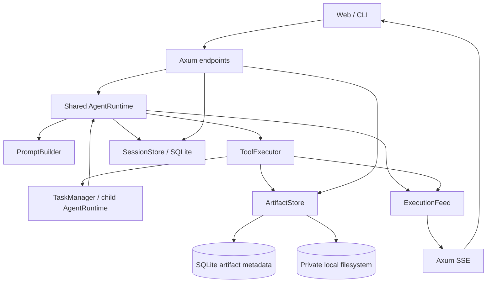
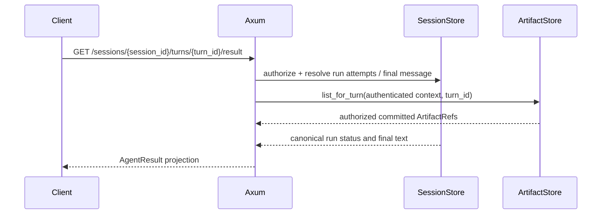
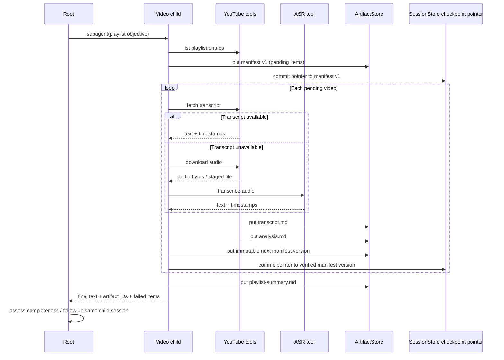
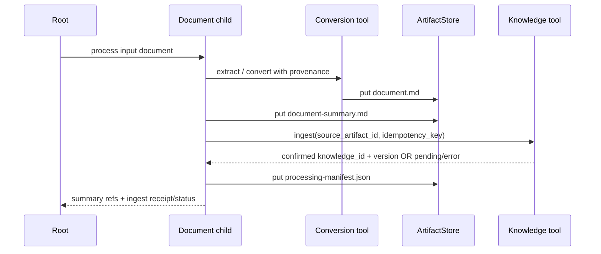

# 17 — Agent Results & Artifacts

**Status:** Proposed design  
**Scope:** Rust/Tokio modular monolith, SQLx/SQLite, local artifact storage, OpenCode-style Root/Subagent sessions.  
**Related:** [02 Agents](02-agents.md), [05 Tools](05-tools.md), [06 Delegation](06-delegation.md), [07 Sessions](07-sessions-context.md), [09 Persistence](09-persistence.md), [11 Flows](11-flows.md), [15 Long-running](15-long-running-sessions.md), [16 Streaming](16-streaming-events.md).

## 17.1. Decisions and non-goals

1. Preserve the existing `subagent(agent, description, prompt, session_id?)` foreground contract. The child emits free-form final text, not a mandatory business JSON schema. Root assesses semantic quality.
2. Separate **execution status** (`agent_runs`) from **business completeness** (reported by Root and/or durable domain manifests). `completed` means the run terminated normally, not that every item succeeded.
3. An `AgentResult` is a **read projection**, not a new source-of-truth row. Combine final message/run status from `SessionStore` with authorized artifact references from `ArtifactStore`.
4. Store large binary/text outputs out of `messages` and `tool_invocations.result_json`; those records contain bounded text, IDs and metadata only.
5. Add one **deep module** `ArtifactStore`, with a small interface hiding immutable publication, integrity, metadata and authorized reads. `AgentRuntime`/`SessionStore` retain execution recovery ownership.
6. Local filesystem + SQLite metadata is the first concrete implementation. No speculative S3 trait until a second adapter is actually needed.
7. Durable batch checkpoints are **domain data**, not SSE progress and not compaction summaries. Reconciliation is mandatory for uncertain external mutations.
8. Artifact creation must not depend on an open HTTP/SSE connection. No general-purpose business task scheduler, event sourcing, blob-in-SQLite or mandatory reviewer agent.

## 17.2. Vocabulary and ownership

- **Artifact**: immutable, committed bytes plus metadata and a stable ID. **ArtifactRef**: bounded descriptor, never bytes or a trusted filesystem path.
- **AgentResult**: read-only view of a logical `turn_id`, its latest run attempt, final text (if confirmed) and authorized artifact references.
- **SessionStore** owns session, turn/run attempts, messages, tool invocation transitions and the **durable manifest pointer**. **ArtifactStore** owns bytes, metadata, publication and authorized reads. **AgentRuntime** owns execution/recovery decisions and message commits. Tool implementations own domain manifest contents and provider reconciliation logic.
- Knowledge entry IDs and provider job IDs are **external receipts**, not local artifacts; primary/intermediate is a listing role, not a separate storage type.

## 17.3. Architecture



`ArtifactStore` is a deep module, not a pass-through facade. It hides staging, atomic publication, hashing, metadata commit and authorized reads. Cross-store invocation recovery belongs to `AgentRuntime` using `SessionStore`; `ArtifactStore` exposes verified refs but does not mutate run/tool state. No storage adapter trait is needed with only a local implementation. `AgentResult` assembly belongs in the read endpoint/application orchestration, not a second stateful result manager.

### Minimal interfaces (illustrative Rust, not compile-checked)

```rust
pub struct ArtifactRef {
    pub id: String,
    pub name: String,
    pub mime_type: String,
    pub size_bytes: u64,
    pub role: ArtifactRole, // Primary | Intermediate; listing/display only
}

pub struct AgentResult {
    pub session_id: String,
    pub turn_id: String,
    pub run_id: String, // latest attempt for this turn
    pub status: RunStatus, // derived from latest attempt, not prior interrupted attempt
    pub output: Option<String>,
    pub artifacts: Vec<ArtifactRef>,
}

impl ArtifactStore {
    pub async fn put(&self, context: &ArtifactContext, input: ArtifactInput)
        -> Result<ArtifactRef, ArtifactError>;
    pub async fn get(&self, context: &ArtifactContext, id: &str)
        -> Result<ArtifactReader, ArtifactError>;
    pub async fn list_for_turn(&self, context: &ArtifactContext, turn_id: &str)
        -> Result<Vec<ArtifactRef>, ArtifactError>;
}
```

`ArtifactContext` is runtime-constructed, includes authenticated owner/workspace/session/turn identity and permission snapshot, and is never accepted verbatim from the model. `ArtifactInput` streams or references staged bytes rather than forcing large in-memory `Vec<u8>`. `ArtifactReader` supports bounded/streamed reads; model-facing `artifact.read` returns a capped text excerpt, range or explicit error. Full downloads stream directly to authorized clients.

The existing `ToolOutcome { call_id, content, metadata }` remains valid: bounded human-readable content plus `metadata.artifact_ids` (verified IDs, not LLM-asserted). `SubagentOutput` remains `{session_id, status, output}`; artifact IDs can be surfaced in bounded text/metadata. Do not require business JSON from the child.

## 17.4. Persistence and filesystem

Use a **new artifact metadata table** alongside the existing four session tables. This is a deliberate scope extension, not a new `tasks` table.

```sql
CREATE TABLE artifacts (
  id TEXT PRIMARY KEY,
  owner_id TEXT NOT NULL,
  workspace_id TEXT NOT NULL,
  session_id TEXT NOT NULL REFERENCES sessions(id),
  turn_id TEXT NOT NULL,
  producer_tool_call_id TEXT,
  role TEXT NOT NULL CHECK(role IN ('primary','intermediate')),
  name TEXT NOT NULL,
  mime_type TEXT NOT NULL,
  size_bytes INTEGER NOT NULL CHECK(size_bytes >= 0),
  sha256 TEXT NOT NULL,
  storage_key TEXT NOT NULL UNIQUE,
  state TEXT NOT NULL CHECK(state = 'ready'),
  created_at INTEGER NOT NULL
);
CREATE INDEX idx_artifacts_turn ON artifacts(workspace_id, turn_id, created_at);
CREATE INDEX idx_artifacts_session ON artifacts(session_id, created_at);
```

Schema is illustrative: use the repository's established ID/clock conventions during migration. A `turn_id` is stable across run recovery; `run_id` may change. Validate `session_id` and turn ownership in application logic/transactions. A tool-call foreign key is optional because calls are scoped by session and historical references must survive recovery. `producer_tool_call_id` must be interpreted together with `session_id`. Avoid duplicating `agent_runs.status` or creating an artifact status state machine for every provider operation.

Physical layout: private configured root directory, server-generated opaque storage keys, staging and committed subdirectories. Never interpolate user filenames into paths. Use create-new staging files, streaming hash/size checks, `fsync` file, atomic rename within same filesystem, directory sync where supported, then metadata publication. Readers only resolve `ready` rows and only server-generated keys. File and DB are not one atomic transaction: if bytes are committed but metadata is absent, an orphan sweep removes them after a safe grace period. If DB references missing/corrupt bytes, return integrity error and flag repair; never claim success. For stronger durability, persist an explicit staging intent internally when warranted by crash tests, without exposing it as an agent-facing status.

Do not overwrite committed bytes. Regeneration creates a new ID. Validate MIME against content where practical, enforce max size, quotas, disk-space reserve, content safety rules and owner/workspace authorization. Hash supports integrity and possible future deduplication; do not deduplicate across tenants by default. External URLs are not filesystem paths or authorization tokens.

### MVP retention boundary

MVP retains committed artifacts without automatic TTL, deletion or reference-aware GC. Do not delete checkpoint inputs during active/recoverable turns. Backup and restore must include both SQLite metadata and files; automated retention, GC and remote storage adapters are future work.

## 17.5. Tool contract, trust and provider operations

- Tool validates input and permissions, performs its work, calls `ArtifactStore.put`, receives verified refs, then returns `ToolOutcome` with bounded text and IDs.
- Runtime persists assistant tool call before side effects; persists final tool result and invocation terminal state after tool returns. Artifact publication may precede tool-result commit: on crash, `AgentRuntime` consults `SessionStore` and verified artifact refs, then reconciles the invocation; `ArtifactStore` never marks tool calls completed or retries external mutations.
- `metadata.artifact_ids` is produced by trusted tool code; never accept IDs solely because model text mentions `artifact://...`.
- `artifact.read` enforces model-visible byte/token caps, path confinement and ACL. `artifact.download` streams bytes to authenticated clients with safe content disposition.
- Provider jobs returning `accepted` are **not** generated media artifacts. Keep provider operation ID and idempotency key in the durable tool-specific checkpoint/invocation metadata. Confirm actual media retrieval, verification and `ArtifactStore.put` before returning a completed media artifact.
- `knowledge.ingest` produces an external receipt (`knowledge_id`, version, source artifact ID). Do not mislabel an accepted ingest request as completed. Check the provider's confirmed state and persist the receipt in invocation metadata or a durable manifest.
- Tool outputs, transcripts, documents and generated content are untrusted model context. No artifact can grant tool permissions or elevate project instructions.

## 17.6. AgentResult projection and read flow



Resolve all `agent_runs` for `(session_id, turn_id)` by monotonic `resume_attempt` (and unique run identity as tie-breaker). The **latest attempt** supplies `run_id` and `status`; an older `interrupted` attempt must not override a newer `running` or `completed` attempt. Return `output` only from the final assistant message committed for the resolved terminal attempt, otherwise `None`. If running, return `status=running` and already published authorized artifacts; do not invent a final answer. `turn_id` remains stable across restarts. A final run can contain partial business outcomes. Paginate artifact lists if large; the minimal struct is a conceptual envelope, not a promise to inline thousands of refs. A projection must never expose child artifacts across owner/workspace boundaries; root-family visibility is policy-checked.

## 17.7. Flow A — YouTube playlist → transcript → ASR → analysis



**MVP checkpoint choice: immutable, versioned `playlist-manifest.json` artifacts only.** No per-item SQLite checkpoint table. Each version contains item identity (playlist/source ID, video ID, processing version), source revision, transcript language/ASR model when applicable, item status (`pending`, `completed`, `failed/retryable`, `blocked`) and verified output artifact IDs. Count an item completed only when its refs exist and pass integrity checks. Root can report 18/20 complete while the run status is `completed`.

**Durable pointer protocol:** After `ArtifactStore.put(manifest_vN)` returns a verified committed ref, the tool requests `SessionStore.commit_checkpoint(session_id, tool_call_id, manifest_id, expected_previous_id)` as a short SQLite compare-and-swap transaction on the **existing `tool_invocations` record** (a `checkpoint_artifact_id` nullable column). The transaction checks invocation ownership, status and expected previous pointer, then bumps the session revision. No new checkpoint table. The tool must not report item completion as durable before this commit. The initial manifest follows the same protocol. `AgentRuntime` coordinates this operation through the trusted tool context; tool code cannot directly write transcript rows.

On restart, recover from the **last committed pointer**, not the newest file or SSE event. A newer manifest whose bytes committed but pointer update did not is an unreferenced candidate, not authoritative; retain it for later inspection (no MVP GC). Verify pointed-to bytes and all completed item refs before skipping work. Missing/corrupt refs require reconciliation or item reprocessing only when safe. Concurrent checkpoint writers on one invocation are rejected by compare-and-swap. When a follow-up uses a new `tool_call_id` in the same child session, explicitly pass the last verified manifest ID into the new invocation and commit it as its initial pointer; do not assume the prior invocation's pointer automatically transfers. Provider-side uncertain mutations still block blind retry. Audio retention must respect source terms and configured limits.

## 17.8. Flow B — PDF/DOCX → Markdown → summary → Knowledge Base



Keep original document provenance, page/section mapping, extraction warnings, checksum and conversion version. Mark Knowledge ingest successful only on confirmed receipt; if provider status is uncertain, reconcile by idempotency key or external lookup before retry. An external Knowledge ID is not a local artifact. Store summary separately from extracted full Markdown; do not inject whole documents into parent model context.

## 17.9. Flow C — image/video generation

```mermaid
sequenceDiagram
  participant R as Root
  participant C as Media child
  participant P as Generation provider tool
  participant F as ArtifactStore
  R->>C: prompt + references
  C->>P: submit generation with idempotency key
  P-->>C: provider job ID / accepted
  loop Until confirmed terminal state
    C->>P: poll job status (bounded per operation)
  end
  alt Generated
    C->>P: download output / thumbnail
    C->>F: put verified media and metadata
    C-->>R: final text + artifact IDs
  else Provider failed
    C-->>R: failure details; no fake artifact
  end
```

Persist provider job ID before losing control of the operation, preferably through a tool-owned durable checkpoint; use provider idempotency if available. Do not re-submit a generation on uncertain crash unless reconciliation proves no existing job. Validate dimensions, duration, MIME, checksum and actual file existence. Return URLs via authenticated download endpoints, not arbitrary provider URLs or base64 in LLM messages.

## 17.10. Crash recovery, idempotency and compaction

| Failure point | Recovery rule |
|---|---|
| Before artifact staging | Retry if underlying tool operation is safe. |
| During staging | Incomplete staging file is invisible; clean after grace period. |
| After file rename, before metadata commit | Orphan file sweep; no published artifact reference. |
| After metadata commit, before tool result commit | Artifact remains durable; reconcile invocation by producer/turn/idempotency key. Do not assume external mutation is safe to replay. |
| After tool result commit, before SSE notification | SQLite state is authoritative; client snapshot resync finds result. |
| During provider generation/Knowledge ingest | Query provider by durable job/idempotency key; if uncertain, block for reconciliation. |
| During context compaction | Preserve objective, manifest IDs, committed artifact refs, failed item IDs and external receipts in checkpoint summary. Full history remains in SQLite. |
| Explicit cancel | Stop active execution; retain committed artifacts and checkpoints per policy. |

`steps=None` and no whole-child timeout remain unchanged. Each LLM/tool operation has its own timeout. SSE `tool.progress` is ephemeral; durable per-item completion is stored separately. Never use a compaction summary as the sole authoritative checkpoint. The latest authoritative manifest is the ID committed to `tool_invocations.checkpoint_artifact_id` via compare-and-swap; an artifact published without that pointer commit is not a completed checkpoint.

## 17.11. SSE, HTTP and UI

Keep existing `ExecutionFeed` taxonomy and `state_revision` invalidation strategy. Do **not** add artifact bytes to SSE or persist every progress tick. A tool's `tool.progress` may include a small item count/preview; `tool.completed` triggers snapshot refresh. When a committed artifact is created before the tool completes, an optional `session.changed` after the relevant metadata/association commit may invalidate the view; do not add a duplicate event type without a concrete UI need. `GET .../result` and authorized artifact list/read/download endpoints are canonical. Subscribe SSE first, then fetch session-family snapshot; on lag/reconnect resync from SQLite. HTTP disconnect does not cancel managed execution.

## 17.12. Security, quotas and operational constraints

- Enforce authenticated owner/workspace/session ancestry on every artifact read, list, download and delete. Do not trust caller-provided IDs, MIME, storage paths or model text.
- Stream data with size caps; enforce per-tool/per-workspace quotas and disk headroom. Refuse oversized outputs with explicit technical errors rather than silent truncation of durable bytes.
- Redact secrets/PII from model-visible previews and logs; log IDs and hashes instead of sensitive file content. Protect generated/downloaded files against path traversal and symlink attacks.
- Keep file root private; no static unauthenticated directory serving. Use short-lived authorized download handles only if later required.
- Verify input type, media metadata and checksums; consider malware scanning for untrusted uploads when deployment warrants it.
- Account for tool cancellation, provider rate limits, ASR cost, video generation cost and local storage exhaustion; none should turn a completed run into a false business-success claim.

## 17.13. Verification plan

**Interface contract tests (same seam as callers):**

1. `ArtifactStore.put/get/list_for_turn`: streamed Markdown/video bytes, stable refs, immutable publication, checksum/integrity errors, workspace/session ownership and bounded reads.
2. `SessionStore` checkpoint compare-and-swap: first pointer, version advancement, stale expected pointer rejection, wrong owner/session rejection; no separate checkpoint table.
3. `AgentResult` read projection: latest `resume_attempt` wins over older interrupted run, final text belongs to resolved attempt, authorized artifact list and no duplicated result state.

**Internal fault-injection tests (implementation details, not public methods):**

4. Crash during staging, after rename before metadata commit, after metadata commit before tool-result commit, and between manifest publication and pointer CAS. Confirm no false success or blind side-effect replay.
5. Missing/corrupt committed manifest or completed-item artifact: block/repair/reprocess only under safe policy; SSE reconnect cannot fabricate checkpoints.

**End-to-end integration tests:**

6. Playlist 20 videos / 18 success / 2 ASR failures; resume same child session from last pointer, skip only verified completed items.
7. PDF conversion succeeds but Knowledge ingest fails/pends: no false Knowledge receipt; retry via provider reconciliation.
8. Media provider accepts job then process restarts: query durable provider job ID, no duplicate generation.
9. >100 model/tool steps, compaction, HTTP/SSE disconnect and restart: final result and artifacts remain reconstructable from canonical stores.

## 17.14. Incremental implementation plan

**Phase A — ArtifactStore core:** local storage, SQLite metadata, `put/get/list_for_turn`, authorized reads, immutable publication and interface/fault-injection tests.

**Phase B — Workload integration:** `tool_invocations.checkpoint_artifact_id` CAS, result projection, playlist/document/media flows, provider reconciliation and end-to-end tests. Retention/GC and remote storage adapters are explicitly deferred.

## 17.15. Compatibility notes and open questions

- `docs/05-tools.md` and `docs/09-persistence.md` currently say a general artifact store is post-MVP. This proposal intentionally changes that scope **when accepted**; update those documents and the decisions ledger in the same future commit, not silently now.
- `AgentResult` is not a replacement for the existing `SubagentOutput`. Do not introduce mandatory `TaskContract`, `ResultValidator`, `Reviewer Agent` or `tasks` scheduler.
- Set concrete maximum file sizes and quotas during deployment configuration; do not introduce GC/TTL or a separate checkpoint table in MVP. Reconsider only with measured workload evidence.
