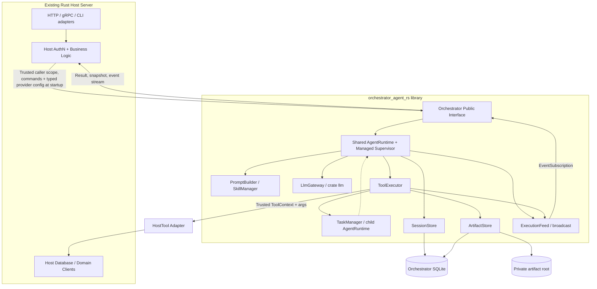
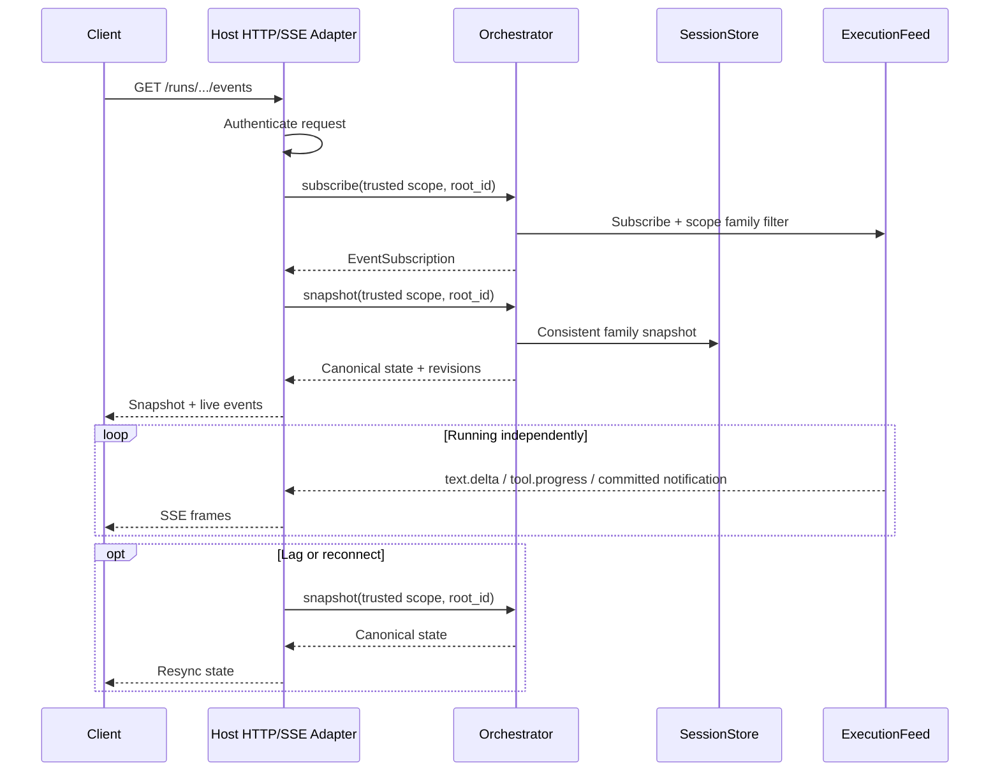
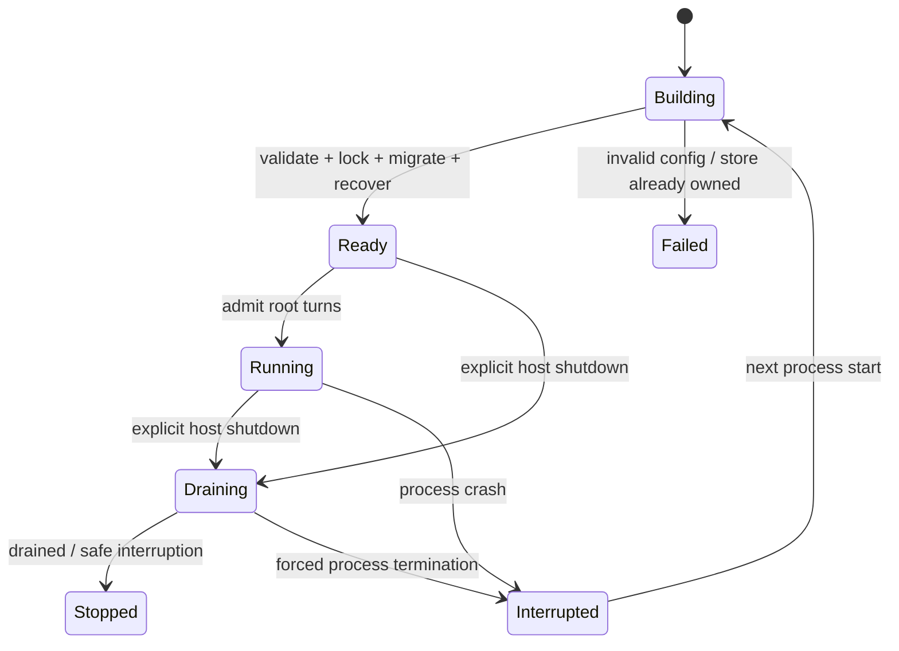
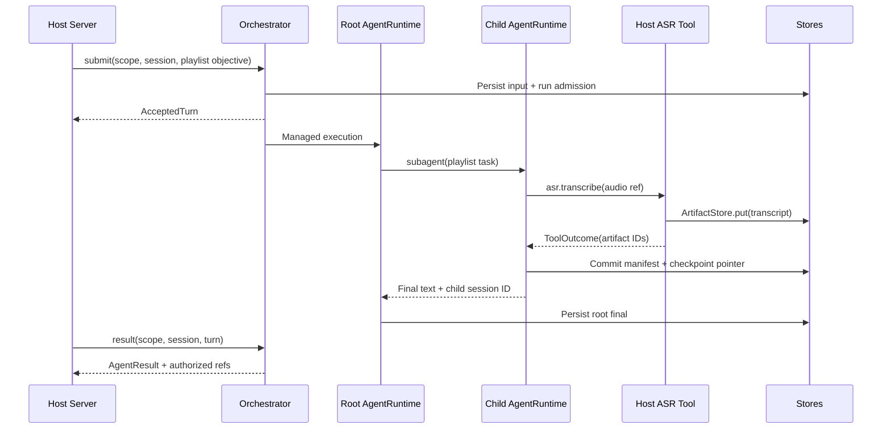

# 18 — Embeddable Rust Library & Host Integration

**Status:** Accepted (v5.0) design — cập nhật sau Codebase Design + Ponytail Review; **chưa phải code đã implement**.  
**Ngày:** 2026-10-20.  
**Mục tiêu:** Xây dựng `orchestrator_agent_rs` thành Rust library có thể nhúng trực tiếp vào một Rust server hiện có.  
**Phạm vi:** External seam, LLM provider configuration/injection, lifecycle, host tool integration, persistence, observation, recovery, packaging, testing.  
**Liên quan:** [00 — Decisions](00-decisions.md), [01 — Architecture](01-architecture.md), [02 — Agents](02-agents.md), [05 — Tools](05-tools.md), [06 — Delegation](06-delegation.md), [07 — Sessions](07-sessions-context.md), [08 — Runtime/LLM](08-runtime-llm.md), [09 — Persistence](09-persistence.md), [10 — Security](10-security-operations.md), [12 — MVP/Test](12-mvp-test-plan.md), [15 — Long-running](15-long-running-sessions.md), [16 — Streaming](16-streaming-events.md), [17 — Agent Results & Artifacts](17-agent-results-artifacts.md).

> **Tính chất tài liệu:** Đây là thiết kế đã Accepted trong baseline v5.0, **không** khẳng định Rust interface bên dưới đã compile hay triển khai. Những thay đổi so với baseline v4.1 được đồng bộ tại mục 18.15 và ADR-015–017.

## 18.1. Problem statement và design goals

Repository hiện định hình **Shared AgentRuntime + parent–child sessions** giống hướng OpenCode: Rust/Tokio, crate `llm`, SQLx/SQLite, Root gọi foreground Subagent bằng tool, context compaction, safe recovery, streaming và artifact-by-reference. Nhiều tài liệu minh họa `main.rs`, Axum router và SSE endpoint như điểm bắt đầu triển khai. Tuy nhiên **đích sử dụng thực tế** là nhúng engine vào một Rust server vốn đã có authentication, routes, database, business logic và observability.

**Goals:**

1. Host tích hợp bằng Cargo dependency và khởi tạo một `Orchestrator` handle; **không phải** chạy một HTTP server thứ hai.
2. Host không cần hiểu `AgentRuntime`, `TaskManager`, `PromptBuilder`, provider stream assembly, SQL schema hay cơ chế compaction/recovery. Host **truyền typed LLM provider config** khi xây dựng Orchestrator; engine tự khởi tạo và quản lý client.
3. Host cung cấp business capabilities (ASR, Knowledge, YouTube, document conversion, media generation, ...) như **HostTool adapters**, không cần sửa mã nội bộ Orchestrator mỗi lần thêm tool.
4. Một root turn có thể chạy hàng giờ; HTTP/SSE disconnect **không** kết thúc managed execution; có thể đọc result/snapshot và recover sau restart.
5. Giữ nguyên contract đã chốt: Root tự đánh giá Subagent final text; `subagent(agent, description, prompt, session_id?)` foreground; **không** mandatory business JSON/semantic validator; **không** deadline toàn child; retry side effects không mù quáng.
6. API host không được làm lộ SQLite query, filesystem path, provider credentials hay transport-specific types ra public interface của engine.
7. Chỉ thêm **hai external seams** có nhu cầu thực: Orchestrator control/observation và HostTool execution. Những seams nội bộ cần cho provider/fake tests không trở thành nghĩa vụ tích hợp của host.

**Non-goals trong MVP:** core bắt buộc Axum/HTTP; dynamic plugins, remote/distributed workers; lossless event replay; generalized storage/provider traits; workflow scheduler/semantic validation bắt buộc. Giữ các giới hạn đã ghi ở [00](00-decisions.md), [15](15-long-running-sessions.md) và [17](17-agent-results-artifacts.md), không liệt kê lại một bộ runtime policy thứ hai.

## 18.2. Quyết định kiến trúc (Accepted design)

| ID | Quyết định | Lý do |
|---|---|---|
| EMB-01 | **Library-first**: `orchestrator_agent_rs` là Cargo library; executable/HTTP là examples hoặc adapters tùy chọn. | Host đã có server và transport. |
| EMB-02 | Expose **một `Orchestrator` handle** với interface điều khiển và quan sát nhỏ; internal modules ẩn sau `pub(crate)`. | Deep module, locality, interface ổn định. |
| EMB-03 | Expose **một `HostTool` extension seam** để đăng ký tool của host. | Đây là biến thiên thực sự; production tool và fake adapter phục vụ tests. |
| EMB-04 | Sử dụng **Tokio runtime của host**; Orchestrator sở hữu supervisor và execution task handles nhưng không tự tạo Tokio runtime toàn cục. | Tránh runtime lồng nhau, shared lifecycle. |
| EMB-05 | Core không biết Axum/Actix/gRPC/SSE: expose `subscribe` + canonical `snapshot`; host thực hiện transport adapter. | HTTP disconnect không phải cancellation. |
| EMB-06 | Orchestrator sở hữu SQLite schema/migration và private artifact directory; mặc định triển khai **DB riêng** với host. | Không ràng buộc database nghiệp vụ của host. |
| EMB-07 | MVP chỉ có **một process owner** cho execution store; khởi tạo instance thứ hai trên cùng store phải fail-fast. | Startup recovery v4.1 chưa có leases/fencing đa process. |
| EMB-08 | AuthN nằm ở host; Orchestrator kiểm tra ownership/workspace, session ancestry, agent/tool/skill permissions **cho từng operation**. | Không tin ID hoặc quyền do LLM/user text cung cấp. |
| EMB-09 | Public `AgentResult` là **read projection** của latest run attempt + authorized artifact refs, không tạo result state table mới. | Giữ ownership đã chốt trong [17](17-agent-results-artifacts.md). |
| EMB-10 | Maintain `AgentRuntime` là implementation runner duy nhất; **không** tạo thêm `OrchestratorEngine` điều phối trùng lặp. | Tránh shallow module và hai nguồn điều phối. |
| EMB-11 | Shutdown theo protocol rõ ràng: stop admission, drain có giới hạn, interrupt/reconcile khi chưa xác nhận side effect; Drop không hứa graceful shutdown. | Host có vòng đời process riêng. |
| EMB-12 | Host **inject typed `LlmConfig`** ở `Orchestrator::builder(config)`; library tự tạo provider clients bên trong `LlmGateway`. | Không buộc host import Rust types của từng provider hay crate `llm`. |
| EMB-13 | `AgentDefinition` tham chiếu cặp `(provider_id, model_id)`; `provider_id` là định danh cấu hình cục bộ, phân biệt với backend kind. | Root/Child có thể dùng nhiều providers, kiểm tra tham chiếu và capabilities trước execution. |
| EMB-14 | Host sở hữu secret resolution; engine không persist/log credentials, không silent fallback; hot reload sau MVP. | Phân chia ownership bảo mật và recovery ổn định. |
| EMB-15 | Public reads gồm paginated `history`/`list_artifacts` và authorized `open_artifact`; `result` chỉ đưa bounded artifact preview. | Host không cần đọc SQLite hoặc private files. |
| EMB-16 | Persist **non-secret provider configuration fingerprint** cho mỗi attempt; recovery so sánh identity trước khi tiếp tục, bỏ qua credential rotation thuần túy. | Không nhầm alias trỏ backend/endpoint khác. |
| EMB-17 | Durable admission phải được supervisor reconcile **trong cùng process**; mutating HostTool outcome unknown bị block và chỉ được giải quyết bằng verified operator action. | Không mất turn đã Accepted và không blind replay. |

**Design vocabulary:** `Orchestrator` là một **deep module** có external **interface** tại seam host↔engine; `HostTool` là external seam cho adapters. `LlmGateway` là internal seam vì provider protocol và fake LLM khác nhau. `AgentRuntime`, `SessionStore`, `ArtifactStore`, `ExecutionFeed` là internal modules/implementations; không expose chỉ để host tự lắp ghép. Chỉ đặt thêm trait khi có hai adapters thật sự cần nó.

## 18.3. Topology và ownership



**Ownership table:**

| Concern | Host | Orchestrator |
|---|---|---|
| Transport, routes, middleware, API response codes | Owner | Không biết framework |
| Xác thực người dùng / lấy owner-workspace từ request | Owner | Tin caller đã xác thực, vẫn enforce scope trong store/runtime |
| Agent run, child sessions, tool invocation state | Không can thiệp trực tiếp | Owner: `AgentRuntime`, `TaskManager`, `SessionStore` |
| Agent/skill policy enforcement | Có thể cấu hình hạn chế | Enforce kỹ thuật tại mỗi call |
| LLM provider config/credentials | Resolve secret từ env/vault, inject typed config lúc build | Validate, giữ kín và quản lý client lifetime |
| LLM provider protocol, model routing, tool-call assembly | Không cần tạo provider clients | Owner: `LlmGateway` |
| Business logic, Knowledge / ASR clients | Owner | Chỉ dùng thông qua tool đã đăng ký |
| Durable execution transcript/checkpoint pointer | Chỉ đọc qua interface | Owner: `SessionStore` |
| Artifact bytes + metadata | Không đọc filesystem trực tiếp | Owner: `ArtifactStore` |
| Live execution events | Quyết định HTTP SSE/WS transport | `ExecutionFeed` publish + subscribe |
| Task supervision / cancellation / recovery | Gọi startup/shutdown/cancel | Owner: managed execution |

**Dependency direction:** Host phụ thuộc vào public types của crate. Nội bộ Orchestrator không phụ thuộc vào host application crate. Đăng ký `HostTool` đảo chiều dependency qua interface; engine không import mã nghiệp vụ của host. Không có vòng `Arc<AgentRuntime>` trong `TaskManager`: như [06](06-delegation.md), truyền runtime borrowed tại nhánh subagent.

## 18.4. Public interface (thiết kế đã chốt)

### 18.4.1. Scope và identities

Không thay đổi nghĩa của các IDs đang có: `session_id`, `turn_id`, `run_id`, `tool_call_id`, `artifact_id`. Có thể dùng `String` trong first implementation và chuyển sang newtype ở public seam khi có lợi ích đủ rõ; **không** phải tạo thêm một hệ thống identity thứ hai.

`CallerContext` được tạo từ authenticated principal của host, gồm `owner_id`, `workspace_id` và các hạn chế trusted nếu có. **Không bao giờ** deserialise nguyên `CallerContext` do LLM, tool arguments hoặc client gửi. Host là trusted integrator; Orchestrator không thể bảo vệ nếu host cố tình giả danh principal, nhưng phải bảo vệ lỗi cross-tenant do ID từ request.

### 18.4.2. Command và read interface

> **Rust illustrative contract, chưa compile-checked.** Tên struct/hàm có thể điều chỉnh trong spike khi triển khai; invariants bên dưới là phần cần giữ ổn định.

```rust
pub struct CallerContext {
    pub owner_id: String,
    pub workspace_id: String,
}

pub struct AcceptedTurn {
    pub session_id: String,
    pub turn_id: String,
}

pub struct Orchestrator { /* private implementation */ }

impl Orchestrator {
    pub async fn create_session(
        &self,
        caller: &CallerContext,
        agent_id: &str,
    ) -> Result<String, OrchestratorError>;

    pub async fn submit(
        &self,
        caller: &CallerContext,
        session_id: &str,
        text: String,
    ) -> Result<AcceptedTurn, OrchestratorError>;

    pub async fn result(
        &self,
        caller: &CallerContext,
        session_id: &str,
        turn_id: &str,
    ) -> Result<AgentResult, OrchestratorError>;

    pub async fn history(
        &self,
        caller: &CallerContext,
        session_id: &str,
        page: PageRequest,
    ) -> Result<Page<MessageView>, OrchestratorError>;

    pub async fn list_artifacts(
        &self,
        caller: &CallerContext,
        session_id: &str,
        turn_id: &str,
        page: PageRequest,
    ) -> Result<Page<ArtifactRef>, OrchestratorError>;

    pub async fn open_artifact(
        &self,
        caller: &CallerContext,
        artifact_id: &str,
    ) -> Result<ArtifactDownload, OrchestratorError>;

    pub async fn snapshot(
        &self,
        caller: &CallerContext,
        root_session_id: &str,
    ) -> Result<SessionFamilySnapshot, OrchestratorError>;

    pub async fn subscribe(
        &self,
        caller: &CallerContext,
        root_session_id: &str,
    ) -> Result<EventSubscription, OrchestratorError>;

    pub async fn cancel(
        &self,
        caller: &CallerContext,
        session_id: &str,
    ) -> Result<(), OrchestratorError>;

    pub async fn resolve_interrupted_invocation(
        &self,
        operator: &OperatorContext,
        session_id: &str,
        invocation_id: &str, // internal tool_invocations.id, not provider tool_call_id
        decision: VerifiedToolResolution,
    ) -> Result<(), OrchestratorError>;

    pub async fn shutdown(&self) -> Result<(), OrchestratorError>;
}
```

- `create_session` chỉ tạo **root** session theo agent mode/host scope được phép; child do `TaskManager` tạo qua `subagent`, không cho host tự gán `parent_session_id` tùy ý.
- `submit` trả `AcceptedTurn` **sau khi** input và run admission claim commit thành công; không đợi final text; one active run/session qua SQLite unique partial index.
- `result` truy xuất latest `resume_attempt` cho `(session_id, turn_id)`; đang chạy thì `output=None`. Trả bounded artifact preview (không bao giờ inline toàn bộ); `completed` chỉ là execution status, **không** khẳng định business completeness.
- `history` đọc canonical message views của **một** authorized session theo cursor/limit; không bao gồm secrets, hidden reasoning hay quyền vượt ra khỏi child session. `list_artifacts` phân trang theo turn, kiểm tra ancestry/workspace trên mọi trang; cursor là opaque, gắn với query scope và deterministic ordering, không phải authorization token.
- `open_artifact` (khả dụng khi ArtifactStore ở M7) trả `ArtifactDownload { metadata, reader }` có reader async/stream được giới hạn và authorization tại thời điểm mở; không expose storage key/path hay load cả binary vào RAM. Host tự map download sang HTTP/gRPC với content disposition an toàn.
- `resolve_interrupted_invocation` nhận **internal `invocation_id`** chứ không nhận provider `tool_call_id` (có thể trùng qua assistant messages); là **operator-only** command được kiểm soát và audit cho tool outcome bị `RECOVERY_BLOCKED`: chỉ chấp nhận bằng chứng đã xác minh, không tự tạo generic `HostTool.reconcile()` (18.6.3).
- `snapshot` là canonical session-family view cho reconnect; đảm bảo ownership/ancestry và đọc transaction nhất quán theo [16](16-streaming-events.md).
- `subscribe` là best-effort realtime, **không** là replay log; gọi `snapshot` sau đăng ký stream để tránh bỏ lỡ committed state. Chi tiết ở 18.8.
- `cancel` là explicit cancellation; propagate parent→currently-active child theo semantics cũ; trả về được sau khi yêu cầu hủy được chấp nhận/persist, không cam kết external provider side effect đã đảo ngược.
- `shutdown` theo protocol 18.9; không phụ thuộc HTTP connection.
- `OrchestratorError` cần stable code cho `INVALID_INPUT`, `PERMISSION_DENIED`, `NOT_FOUND`, `SESSION_BUSY`, `RECOVERY_BLOCKED`, `PROVIDER_CONFIG_CHANGED`, `STORE_ALREADY_OWNED`, `SHUTTING_DOWN`, `UNAVAILABLE`, `INTERNAL`; thông tin bí mật bị sanitize. Không thiết kế hierarchy exception dài ngay MVP.

**Read/reconciliation value types (illustrative, không compile-checked):**

```rust
pub struct PageRequest { pub cursor: Option<String>, pub limit: u32 }
pub struct Page<T> { pub items: Vec<T>, pub next_cursor: Option<String> }
// ArtifactDownload owns a bounded async reader and safe display metadata.
// OperatorContext is minted by trusted host authentication/authorization,
// checked again for owner/workspace + operator capability by the engine.
pub enum VerifiedToolResolution {
    ConfirmedCompleted { outcome: ToolOutcome, evidence: String },
    ConfirmedNoEffect { evidence: String },
}
```

`history` và `list_artifacts` dùng chung `PageRequest/Page<T>`; limit được cap bởi engine, cursor không thể tái sử dụng ở session/turn khác và mỗi trang đều xác thực scope. `MessageView` chỉ chứa canonical, authorized, redacted conversation data (không raw prompt/system secrets). `ConfirmedCompleted` chỉ được chấp nhận khi evidence được operator xác minh bằng hệ thống nguồn, internal invocation ID đúng (provider call ID chỉ dùng pairing trong response) và artifact refs đã committed/authorized. `ConfirmedNoEffect` kết thúc invocation bằng **technical failure**, không báo giả thành công và không tự replay mutation. Transaction ghi quyết định + transcript result tương ứng trước khi supervisor tiếp tục turn tại safe point. Không có reconciliation tự động tổng quát trong MVP.

**Phương thức để cân nhắc, chưa bắt buộc external interface MVP:**

- `wait(session_id, turn_id)`: host worker có thể đợi final thay vì polling, nhưng logic chạy **không** được phụ thuộc waiter còn sống. Nếu thêm, phải có ownership check và cancellation của `wait` **không** cancel run.
- `resume(session_id)`: cần cho operator/user-triggered restart sau khi reconciliation; **không** được bypass `SESSION_BUSY` hay unknown mutating outcome. Có thể là một explicit command mở rộng sau khi thiết kế recovery workflow, không expose direct `AgentRuntime.resume` tùy tiện.
- Tool-specific **automatic** reconciliation: chỉ thêm khi có operation IDs/idempotency thực tế được kiểm chứng; không thêm trait speculative.

## 18.5. Bootstrap, configuration và injection

`OrchestratorConfig` tối thiểu chứa agent definitions/config source, prompt/skill roots, **typed `LlmConfig` + host-resolved provider credentials**, SQLite URL/owned path, artifact storage root, tool/resource limits, recovery/compaction, event buffer và graceful shutdown policy. Ưu tiên typed config; YAML/TOML loader là lựa chọn ở host, **không** bắt host phải đặt `agents.yaml` ở một vị trí cứng. Registry load lúc startup, snapshot agent definitions theo từng run; hot reload sau MVP. Chi tiết tại mục 18.5.1–18.5.7.

**Khởi tạo theo thứ tự:**

1. Host khởi chạy bên trong **Tokio runtime hiện có** và chuẩn bị external clients/secrets.
2. Builder validate tools (unique names/schema), agent modes, policy, skill roots, **unique provider IDs, agent provider references, auth presence và cấu hình tĩnh**; tạo client handles bên trong `LlmGateway`. Capabilities không thể kiểm chứng tĩnh được kiểm tra tại request/provider smoke (18.5.4).
3. Acquire **single-owner store lock**: trên local filesystem, giữ OS advisory lock độc quyền suốt vòng đời engine; từ chối process khác dùng cùng execution DB. SQLite partial unique index bảo vệ concurrent runs/session nhưng **không thay thế** process owner lock cho startup recovery.
4. Mở SQLx pool, chạy migrations riêng của Orchestrator, bật WAL/FK/busy timeout; validate artifact root và quyền truy cập.
5. Khởi tạo concrete modules và managed supervisor; resolve stale runs/invocations theo [15](15-long-running-sessions.md). Unknown mutating outcomes được block chờ reconciliation.
6. Chỉ sau khi engine sẵn sàng mới nhận `create_session`/`submit` (nếu recovery background chưa xong thì các session liên quan vẫn phải thể hiện trạng thái recover/block rõ ràng).

Nếu application host cũng có migrations/database khác, **không** dùng transaction cross-DB cho execution của Orchestrator. Host tool tích hợp domain DB phải thiết kế idempotency/reconciliation tại seam riêng (18.6). Không yêu cầu host sử dụng SQLx, SQLite hay artifact filesystem của Orchestrator.

**Failure ordering của `submit`:** persist input + active-run claim trong một transaction trước Accepted. **Accepted = durable admitted, không có nghĩa LLM đã bắt đầu.** Supervisor đăng ký task theo `run_id` (idempotent) và kiểm tra các durable active claims chưa có in-memory owner sau admission, khi worker kết thúc, và qua bounded periodic sweep trong lúc process còn sống. Claim bị hụt sau DB commit nhưng trước spawn phải được reschedule hoặc chuyển sang explicit recoverable/blocked state; không để stuck `running` vô hạn chỉ vì thiếu task. Khi process crash, [15](15-long-running-sessions.md) xử lý restart recovery; khi cùng process còn sống, supervisor chịu reconciliation. Không spawn duplicate cho một `run_id` và không bypass single active run/session. Submission sau `SHUTTING_DOWN` bị từ chối **trước** admission.


### 18.5.1. Quyết định: host truyền cấu hình, library quản lý clients

**Có: server truyền `LlmConfig` vào library khi khởi tạo.** Không truyền trực tiếp `OpenAIClient`, `AnthropicClient`, `llm::LLMProvider` hay HTTP client riêng của host trong MVP. Host chỉ quan tâm tới backend, endpoint được phép, credentials, timeout và model được từng agent chọn. `LlmGateway` (internal seam) ánh xạ cấu hình đó sang crate `llm`, chuẩn hoá stream/tool calls/errors và quản lý client reuse/lifetime.

**Luồng ownership:** host resolve secrets → `Orchestrator::builder` validate config và tạo `LlmGateway` clients → `AgentRuntime` resolve `(provider_id, model_id)` của agent đã admit → gateway normalize provider streaming và tool calls. Cấu hình LLM **không** đi vào `submit()` và không được tạo từ request body của người dùng. Không tạo một public `ProviderManager` facade nữa: host chỉ cần gọi `Orchestrator::builder(config)`.

### 18.5.2. Typed config contract (illustrative Rust)

```rust
// Conceptual public types, NOT compile-checked / not the crate llm's actual API.
pub struct OrchestratorConfig {
    pub llm: LlmConfig,
    pub agents: Vec<AgentDefinition>,
    // persistence, artifacts, prompts, skills, policies, events, ...
}

pub struct LlmConfig {
    pub providers: Vec<LlmProviderConfig>,
}

pub struct LlmProviderConfig {
    pub id: String,                    // e.g. "openai-main" (unique alias)
    pub backend: LlmBackend,           // OpenAi | Anthropic | Gemini | Ollama | OpenAiCompatible
    pub endpoint: Option<String>,      // allowlisted/validated, optional for standard providers
    pub auth: ProviderAuth,            // secret is provided by trusted host
    pub request_timeout: std::time::Duration, // per LLM request, not entire agent run
}

pub enum ProviderAuth {
    None,                              // e.g. approved local Ollama endpoint
    ApiKey(SecretString),              // redacted / non-serializable secret wrapper
}

// AgentDefinition is already defined in docs/02-agents.md:
// its provider_id must reference LlmConfig.providers, and model_id
// is a provider-native model identifier. Do not redeclare it here.
```

Các tên `LlmBackend`, `ProviderAuth`, `SecretString` và fields là **contract đề xuất của library**, không phải type được xác nhận từ crate `llm`; việc ánh xạ backend sang các builders thực tế nằm hoàn toàn bên trong `LlmGateway`. `SecretString` chỉ biểu đạt một kiểu che giấu secret (có thể dùng `secrecy` hoặc type nội bộ đã kiểm chứng). Không yêu cầu serialize credentials sang YAML/JSON hoặc SQLite.

- `id` là **instance alias** do host cấu hình, ví dụ `openai-main`, `openai-fallback-region`, `anthropic-main`. Hai alias có thể cùng một backend nhưng credentials/endpoint khác; `id` không phải tên backend.
- `backend` quyết định adapter của crate `llm`; `endpoint` tùy chọn và cần được xác thực/giới hạn từ cấu hình tin cậy. Địa chỉ nội bộ/local chỉ được cấu hình bởi host, không lấy từ model output hay prompt.
- `(provider_id, model_id)` nằm trong `AgentDefinition` như [02](02-agents.md); Root và Child sử dụng riêng model đã resolve. Không cần có một `default_model` thứ hai trên toàn hệ thống khi mỗi agent đã cấu hình tường minh.
- Request policy như timeout, retry/rate limit và budgets áp tại Gateway/runtime. `request_timeout` chỉ đo **một** call LLM, không là whole-session deadline; `agent.steps=None` vẫn giữ.

### 18.5.3. Rust host wiring: hai remote providers + một local provider

```rust
// Illustrative host-side wiring: secrets are resolved BEFORE build().
let openai_key = host_secret_manager.get("OPENAI_API_KEY").await?;
let anthropic_key = host_secret_manager.get("ANTHROPIC_API_KEY").await?;

let llm = LlmConfig {
    providers: vec![
        LlmProviderConfig {
            id: "openai-main".into(),
            backend: LlmBackend::OpenAi,
            endpoint: None,
            auth: ProviderAuth::ApiKey(SecretString::new(openai_key)),
            request_timeout: Duration::from_secs(120),
        },
        LlmProviderConfig {
            id: "anthropic-main".into(),
            backend: LlmBackend::Anthropic,
            endpoint: None,
            auth: ProviderAuth::ApiKey(SecretString::new(anthropic_key)),
            request_timeout: Duration::from_secs(120),
        },
        LlmProviderConfig {
            id: "ollama-local".into(),
            backend: LlmBackend::Ollama,
            endpoint: Some("http://127.0.0.1:11434".into()),
            auth: ProviderAuth::None,
            request_timeout: Duration::from_secs(180),
        },
    ],
};

let config = OrchestratorConfig {
    llm,
    agents: vec![
        AgentDefinition::new("root", "openai-main", "<provider-model-id>"),
        AgentDefinition::new("researcher", "anthropic-main", "<provider-model-id>"),
        AgentDefinition::new("local", "ollama-local", "<local-model-id>"),
    ],
    // other config is host-provided
};

let orchestrator = Orchestrator::builder(config)
    .register_tool(Arc::new(HostSearchTool::new(search_client)))
    .build()
    .await?;
```

`AgentDefinition::new(...)`, `SecretString::new(...)` và toàn bộ sample là pseudocode/illustrative Rust, **không phải code được compile**. Một host thực tế có thể đọc YAML/TOML để tạo non-secret config, sau đó gắn credentials từ Vault/env vào typed values và truyền vào builder. Không bắt library tự tìm `OPENAI_API_KEY` bằng `std::env::var`, không bắt host phải biết kiểu `llm::builder::LLMBuilder`.

### 18.5.4. Provider routing, capability validation và error policy

1. **At build (static validation only):** unique aliases, agent references, backend/endpoint syntax/trust, auth presence, timeout > 0, nonempty model IDs và khả năng **đã biết chắc** từ bảng capability tĩnh. Không ping provider hay cam kết credential hoạt động.
2. **At request / explicit provider smoke:** kiểm tra tool calling, system messages, streaming khi các capability phụ thuộc provider/model/runtime response. Không giả định một model hỗ trợ tool chỉ vì backend có adapter; trả `UNSUPPORTED_CAPABILITY`/provider error rõ ràng. Fail trước side effect khi thiếu tool-call capability.
3. **At run:** runtime resolve `agent_id → (provider_id, model_id)` theo snapshot đã admit; `LlmGateway` lấy provider client đã cấu hình. Parent/Child cùng gateway nhưng **không** chia model policy hay session histories.
4. **Stream normalization:** Gateway chuyển provider text fragments, assembled tool calls, usage/finish/error sang internal `ModelEvent`; chỉ sau toàn bộ provider response `Finished` runtime mới persist đầy đủ invocations và execute tools. Provider nào không hỗ trợ tool-call streaming có thể dùng fallback non-streaming **chỉ nếu** có thể giữ ordering/semantics bắt buộc; không chạy tool từ partial response.
5. **Failure:** `MODEL_NOT_CONFIGURED`, `PROVIDER_UNAVAILABLE`, `PROVIDER_AUTH_FAILED`, `UNSUPPORTED_CAPABILITY`, `PROVIDER_TIMEOUT` phải map sang sanitized internal/public error codes. Không lộ API key, raw provider headers hoặc response bodies. Không tự động fallback OpenAI→Anthropic khi có lỗi; model substitution cần policy/ADR rõ ràng sau MVP.
6. **Init/connectivity:** `build()` validate **local configuration** và tạo client handles, không bắt buộc ping mọi remote provider hay gọi request tốn phí khi host startup. Reachability/auth failures ở runtime; optional explicit provider smoke check là công cụ vận hành, không được âm thầm thay policy.

### 18.5.5. Secrets, logging và credential rotation

- **Host owns acquisition:** lấy secret từ vault/env/host secret manager, chuyển vào non-`Debug`, redacted secret wrapper trong process. YAML/TOML chỉ lưu provider IDs, backend, endpoint và secret references; không lưu raw API keys.
- **Library owns use:** credentials chỉ được đưa vào đúng backend client; không persist trong `sessions`, `agent_runs`, `messages`, checkpoints hoặc artifacts. Không gửi tới LLM prompt, SSE, tool outputs hay `tracing` fields.
- **Isolation:** không cho model/tool arguments chọn endpoint, credential hoặc provider tuỳ ý. Agent config và tool permission được validate trước run; endpoint phải được host tin cậy cấu hình để ngăn SSRF và credential exfiltration.
- **Rotation:** MVP dùng config snapshot tại startup; đổi credential cần rebuild/restart library theo graceful lifecycle. Thay secret thuần túy không đổi fingerprint/routing identity; đổi backend/endpoint cần explicit recovery check. Hot reload sau MVP.

### 18.5.6. Durability: provider fingerprint và recovery compatibility

- Persist `(provider_id, model_id, provider_config_fingerprint)` vào **mỗi `agent_runs` attempt** khi admission. Fingerprint là SHA-256 (có version, canonical encoding) của các trường **non-secret làm thay đổi routing**: backend kind, endpoint chuẩn hóa, deployment/region/API-version hoặc tùy chọn provider-specific tương đương. Không đưa auth token, secret reference, request timeout hay plaintext credentials vào hash; không persist raw endpoint chứa credentials (URL có userinfo/secret query bị reject tại build). Thêm cột `agent_runs.provider_config_fingerprint` bằng migration; dữ liệu legacy thiếu fingerprint được đánh dấu cần operator review nếu phải recover.
- `provider_id` là alias, **không phải identity đầy đủ**; alias vẫn có thể trỏ endpoint khác sau restart. Recovery của cùng `turn_id` đối chiếu fingerprint của attempt cũ với config active trước khi tạo attempt mới. Nếu khác, block `PROVIDER_CONFIG_CHANGED`/`RECOVERY_BLOCKED`, không tự fallback, không tự tiếp tục trên backend mới. Khôi phục config cũ hoặc dùng explicit operator workflow với bằng chứng phù hợp.
- Secret rotation **chỉ** thay credentials không đổi fingerprint; không tự block recovery vì API key mới. New user turns sau restart được dùng cấu hình hiện hành; historical run identity không bị rewrite. Agent definition vẫn snapshot ở lúc admit như [02](02-agents.md).
- Nếu provider outage, trả lỗi/recoverable theo runtime policy; model retry có giới hạn và không phát lại unknown mutating side effects.

### 18.5.7. Phạm vi crate `llm`, testing và quyết định để sau

Crate [`llm`](https://docs.rs/llm/latest/llm/) mô tả unified interfaces cho nhiều backend, streaming và tool calls; có module [`builder`](https://docs.rs/llm/latest/llm/builder/index.html). Đây là căn cứ lựa chọn **internal adapter**, không cam kết mọi model/provider hỗ trợ cùng capabilities. Trước implementation phải **pin chính xác crate version** trong `Cargo.lock`, compile spike với ít nhất hai providers và xác minh multi-turn tool calls, streaming, errors, request timeout, response-finished ordering và model-specific limits. Không copy thẳng `llm` public types ra external interface của Orchestrator.

Provider config contract tests: [12](12-mvp-test-plan.md) (AT-46/48 và related security/recovery cases). Fake `LlmGateway` chỉ dùng trong internal tests; không thêm public generic provider trait.

**Deferred:** host inject một provider client đã dựng sẵn; dynamic provider registry, hot reload/rotation không restart; automatic cross-provider fallback; per-user arbitrary model selection; remote provider control plane. Chỉ thêm external provider seam khi thực sự tồn tại hai host-owned adapters và contract tests biện minh được complexity.

## 18.6. HostTool: external tool extension seam

### 18.6.1. Contract

```rust
#[async_trait::async_trait]
pub trait HostTool: Send + Sync {
    fn descriptor(&self) -> ToolDescriptor;

    async fn execute(
        &self,
        context: ToolContext,
        args: serde_json::Value,
    ) -> Result<ToolOutcome, ToolError>;
}

// Conceptual fields, not compile-checked.
pub struct ToolDescriptor {
    pub name: String,
    pub description: String,
    pub input_schema: serde_json::Value,
    pub effect: ToolEffect, // ReadOnly | Mutating
}
```

**Why a trait here?** Host thực sự có nhiều concrete adapters (ASR/Knowledge/YouTube) và tests cần scripted fake. `ToolExecutor` vẫn là một internal concrete module xử lý schema/permission/dispatch/result caps; không tạo một lớp dispatcher trong host.

**Execution ordering giữ nguyên:**

1. `LlmGateway` hoàn tất và validate toàn bộ provider response; `ToolCallReady` **chưa** kích hoạt tool.
2. `AgentRuntime` persist assistant tool-call message cùng **tất cả** `tool_invocations(requested)` trước side effect.
3. `ToolExecutor` validate schema, agent/tool allowlists, caller-derived scope và budgets, rồi mới gọi `HostTool.execute`.
4. HostTool trả `ToolOutcome { call_id, content, metadata }` với text bounded và verified artifact IDs; `AgentRuntime` commit tool-result message + invocation terminal state trong transaction rồi emit committed invalidation.
5. MVP dispatch sequential theo provider order. Chỉ mở LLM step tiếp theo sau khi mọi outcome được settled.

### 18.6.2. ToolContext là scoped capability, không phải SessionStore

`ToolContext` là **canonical public context** (docs/05 và 16 chỉ tham chiếu) do trusted runtime mint; không tin input/claims của LLM. `scope()` phân biệt internal `tool_invocations.id` với provider call ID và mang cancellation/effective permission snapshot. Có thể expose các **concrete scoped handles**, không mở direct SQL/storage paths:

| ToolContext operation | Semantics |
|---|---|
| `context.progress(update)` | Ephemeral best-effort `tool.progress`, bounded, nonblocking, không checkpoint. |
| `context.is_cancelled()` / token | Cooperative cancel; external mutation đã thực hiện có thể cần reconcile. |
| `context.scope()` | Read-only authenticated owner/workspace/session/run/tool-call identity và effective permissions. |
| `context.artifacts().put(...)` | Immutable commit qua ArtifactStore, trả verified `ArtifactRef`; không viết file trực tiếp ngoài private storage root. |
| `context.artifacts().open(id)` | Bounded async reader của committed artifact input, enforce effective permissions + owner/workspace + explicit invocation input/ancestry scope, từ chối corrupt/out-of-scope refs; không lộ paths. |
| `context.checkpoint().current()` | Đọc verified last committed manifest pointer của **đúng invocation**; trả `None` nếu chưa có. Không suy đoán file mới nhất. |
| `context.checkpoint().commit(manifest_id, expected_previous_id)` | Commit immutable manifest đã verified bằng CAS trên `tool_invocations.checkpoint_artifact_id` của **đúng internal invocation ID**, trả conflict nếu pointer đã đổi. |

Đây là **concrete scoped capabilities**, không sinh thêm `CheckpointStore` trait hay public `SessionStore`. `current()` chỉ đọc pointer đã commit cho invocation hiện tại; khi follow-up sử dụng **invocation mới**, tool phải được truyền manifest ID cũ bằng trusted continuation và commit làm initial pointer theo [17](17-agent-results-artifacts.md); không tự kế thừa pointer chỉ vì cùng child session. HostTool không sửa history; Runtime là workflow writer.

### 18.6.3. Side effects và idempotency

`ToolEffect` là technical classification; một tool khai báo `ReadOnly` sai không tự trở nên an toàn. Đối với mutating calls (Knowledge ingest, media submit), **MVP không có `HostTool::reconcile` hoặc auto replay**:

1. Runtime persist invocation trước khi gọi `execute`. Tool persist idempotency key/provider operation ID trong durable metadata/checkpoint **trước khi coi lệnh submit bên ngoài đã được xác nhận**, khi provider hỗ trợ. `accepted/pending` không phải `completed`.
2. Sau crash khi outcome không xác định, invocation giữ `interrupted`/unresolved và dependent turn hiển thị **derived `RECOVERY_BLOCKED`**; đây là read/error state, **không** thêm run status `recovery_blocked` hay bảng mới. Supervisor không gọi lại `execute` và không đưa dangling tool-call/result pair vào model. Truy xuất operator view thấy tool name, invocation ID, safe receipts và checkpoint, không raw secrets.
3. **Host operator** dùng chính domain client để xác minh external effect. Chỉ operator scope có quyền `reconcile` (host mint sau AuthN/AuthZ; Orchestrator tái kiểm tra owner/workspace + capability) mới gọi `resolve_interrupted_invocation` với evidence và `VerifiedToolResolution`. `ConfirmedCompleted` commit result đã xác minh; `ConfirmedNoEffect` commit terminal technical failure, **không** tự chạy lại mutation.
4. Runtime ghi tool-result + invocation terminal state trong SQLite transaction và audit (chỉ safe receipt/evidence reference, redacted), publish committed notification rồi supervisor mới resume nếu toàn bộ unresolved invocations của turn đã settled **và** provider identity vẫn tương thích. Nếu chưa chứng minh được outcome, **giữ blocked**. Không giả `completed` hoặc `cancelled` trong trường hợp unknown.

Tool-specific automated reconciliation chỉ thêm sau khi chứng minh được idempotency/lookup contract của một provider thực tế. Host DB và SQLite của Orchestrator không có distributed transaction; exactly-once không được cam kết.

### 18.6.4. Built-in vs host tools

- **Built-in internal tools**: `subagent`, `skill`, và các artifact read operations cần thiết. Bảo toàn semantics [04–06](04-skills.md).
- **HostTool adapters**: ASR, YouTube, document conversion, Knowledge, media generation, domain search/write, ... được host chọn đăng ký.
- Không cho host đăng ký tên trùng với built-in reserved tools; permission enforcement thống nhất đối với cả hai nhóm.
- `ToolDescriptor` chỉ cung cấp model-facing metadata/technical classification; **không** tự cấp quyền. Effective permissions vẫn nằm ở agent/tool/runtime policy.

## 18.7. AgentResult, artifacts và storage ownership

**AgentResult read projection (giữ [17]):**

```rust
pub struct AgentResult {
    pub session_id: String,
    pub turn_id: String,
    pub run_id: String,        // latest attempt of this logical turn
    pub status: RunStatus,
    pub output: Option<String>,
    pub artifact_preview: Vec<ArtifactRef>, // bounded first page, e.g. <= 20
    pub artifacts_next_cursor: Option<String>,
}
```

`AgentResult` không phải record/table mới. `SessionStore` resolve latest attempt theo `resume_attempt`, status và `agent_runs.final_message_id` belonging to the same `messages.run_id` attempt; `ArtifactStore` cung cấp authorized committed refs. Nếu attempt mới còn chạy, không dùng final text của attempt cũ. `artifact_preview` bị cap (gợi ý 20 refs), `artifacts_next_cursor` dùng tiếp qua `list_artifacts(caller, session_id, turn_id, page)`; các trang có stable ordering `(created_at, id)`, opaque cursor scoped theo turn/owner. Không materialize hàng nghìn refs vào `result()`. `completed` không đồng nghĩa nghiệp vụ đã thành công.

**Ownership:**

- `SessionStore` sở hữu sessions/turns/runs/messages/tool invocations, `child_turn_id`, `agent_runs.final_message_id`, revision và `tool_invocations.checkpoint_artifact_id` durable pointer.
- `ArtifactStore` sở hữu immutable bytes, SQLite artifact metadata, staging → atomic publication, authorized reads và integrity verification.
- `AgentRuntime` sở hữu execution ordering, transcript commits và recovery decisions; `Orchestrator` lắp `AgentResult` như một **read projection** từ hai stores, không tạo stateful `ResultManager`.
- Tool implementations sở hữu domain manifest schema, provider receipts, idempotency/reconciliation semantics; external IDs không phải local artifact refs.

**Storage MVP:**

```text
<host application database>          # arbitrary, host-owned
<orchestrator.db>                     # dedicated SQLite, Orchestrator-owned
<artifact-root>/staging/             # private
<artifact-root>/committed/           # private, opaque storage keys
```

Backup/restore gồm SQLite **và** artifact files, ở một consistent recovery point. Không backup mỗi `.db` khi WAL đang hoạt động mà bỏ qua WAL; dùng supported SQLite backup flow. Đừng ghi artifact payload lớn vào `messages` hoặc `tool_invocations.result_json`.

**Download/read:** `Orchestrator::open_artifact(caller, artifact_id)` là **MVP contract ở M7**: trả `ArtifactDownload` gồm committed metadata (MIME/name/size/hash) và **bounded, backpressure-aware async reader**. Reader không expose private path, bytes không bị gom thành `Vec<u8>`; streaming transport do host thực hiện, safe content disposition và download limit enforced. Authorization thuộc library; integrity check được thực hiện khi mở và/hoặc trong quá trình đọc, báo lỗi nếu corrupt (không hứa kiểm chứng toàn bộ checksum trước khi stream bytes). Model-facing `artifact.read` có giới hạn nhỏ hơn host download. Không tạo thêm `ArtifactAccessProvider` trait/`artifacts()` facade.

**Checkpoint manifest:** manifest được commit vào ArtifactStore trước, sau đó SessionStore commit verified pointer với compare-and-swap trên invocation hiện hữu. Sau crash luôn dùng **last committed pointer**, không dùng file mới nhất hoặc SSE event; artifact chưa được pointer tham chiếu không được giả làm completed work. Follow-up qua invocation mới phải explicit carry manifest ID vào invocation mới như [17](17-agent-results-artifacts.md).

## 18.8. Streaming và host transport adapters

`ExecutionFeed` vẫn concrete Tokio broadcast, events mang `root_session_id`, `session_id`, optional `run_id`, optional committed `state_revision`, timestamp và payload. **Không** xuất SSE `Event`/Axum types từ core crate.



**Invariants:**

- Subscribe **trước**, snapshot **sau** để hội tụ kể cả child được tạo trong lúc reconnect. Host adapter/client định kỳ refresh canonical snapshot (ví dụ 30s) khi có active run kể cả stream vẫn connected, phòng DB terminal commit xảy ra nhưng publication bị mất. Subscriber chậm phải xử lý `Lagged`/`resync.required`; committed notifications chỉ invalidate snapshot, **không** phải patches.
- `text.delta` và `tool.progress` ephemeral, có thể mất; final committed message và run state đọc lại qua snapshot/result. **Không** hứa `Last-Event-ID`, historical replay hoặc persist từng token.
- Host adapter chịu authentication, heartbeat, SSE/WebSocket/CLI serialization, connection lifetime và rate limits; connection close không cancel run.
- Core phải enforce owner/workspace/child ancestry; một `root_session_id` do client đoán không cho phép đọc family người khác. Đối với subscription lâu, host chịu chính sách hết hạn/re-auth, core không mặc nhiên coi connection là authority mới.
- Sử dụng cùng events cho Root, Child và Tool; `subagent`/`skill` đã nằm trong generic `tool.*`. Không phát thêm duplicate event taxonomy.
- `subscribe` không trả raw private reasoning, secrets, raw provider responses hay unrestricted tool arguments.

## 18.9. Managed Tokio execution và lifecycle



### Startup / run ownership

- Library chạy trong host Tokio runtime; **không** gọi `#[tokio::main]`/`Runtime::new()` trong core, không spawn thread-local fire-and-forget không quản lý.
- Một owned supervisor giữ task handles và cancellation tokens cho accepted root turns; foreground children thuộc cây execution được quản lý, không phụ thuộc network waiter.
- `submit` admission trước, supervisor schedule sau; periodic/triggered reconciliation **trong cùng process** xử lý admitted run chưa được attach task (18.5). Sau process crash, startup recovery kiểm tra safe resume/reconcile; không có hai owners trên cùng `run_id`.
- `steps=None` mặc định: có thể hàng trăm LLM/tool steps. Timeout chỉ áp từng request/tool operation (có config), không có deadline toàn child hay parent theo mặc định.
- Parent explicit cancel propagate xuống active children; child đã commit artifacts/checkpoints vẫn được giữ theo [17].

### Shutdown protocol

1. Supervisor chuyển sang `Draining`; từ chối `submit` mới với `SHUTTING_DOWN` (không nhận rồi làm mất request).
2. Đang chạy được graceful drain trong **configured host shutdown grace**; không đặt mặc định deadline bình thường cho child chỉ vì server shutdown.
3. Hết grace: yêu cầu cooperative cancel, dừng khởi động bước/tool mới; nếu side effect đang mơ hồ, ghi `interrupted`/reconciliation-required hoặc giữ durable invocation pending theo recovery protocol — **không** giả kết quả `completed/cancelled`.
4. Chỉ sau khi **mọi owned local write-capable task đã quiesce/join**, sync durable state, close resources rồi mới giải phóng owner lock. Tool không cooperative sau grace: shutdown trả incomplete/error, **không** báo Stopped hoặc release lock khi local task còn có thể ghi. Force-kill được xử lý như crash; external operation đã gửi vẫn phải reconcile riêng.
5. `Drop` không thể `await`; nếu host drop handle/force-kill mà không gọi `shutdown`, xử lý như crash khi restart. Không tuyên bố Drop đồng nghĩa graceful shutdown.

Host phải giữ `Orchestrator` sống trong application state và gọi `shutdown` khi process nhận stop signal. `wait` (nếu expose) chỉ là waiter; host request cancellation không có nghĩa cancel execution.

**Single-owner invariant:** V4.1 SQLite partial unique index chặn hai active runs/session, **nhưng không giải quyết** hai processes cùng quét stale runs để recovery. MVP bắt buộc local exclusive process lock trên execution store hoặc orchestration owner guard tương đương, fail-fast nếu bị chiếm. Không quảng cáo multi-process hoạt động an toàn. Network/shared filesystems và clustered host cần lease/fencing protocol riêng sau MVP.

## 18.10. End-to-end host integration flows

### Flow A — Root/Subagent gọi Host ASR tool



Child history vẫn riêng; Root đánh giá chất lượng của child result và có thể follow-up với `session_id` cũ. ASR timeout/cost và provider-side reconciliation do adapter và runtime policy xử lý; không trộn business logic vào `AgentRuntime`.

### Document/Knowledge và media generation

Các luồng nghiệp vụ đầy đủ (conversion, verified Knowledge receipt, provider job ID, artifact publication và crash windows) đã có tại [17 — Agent Results & Artifacts](17-agent-results-artifacts.md). Điểm riêng của embedding: host đăng ký `document.convert`, `knowledge.ingest`, `media.generate` như `HostTool`, dùng `result/list_artifacts/open_artifact` để đọc, dùng `subscribe/snapshot` để theo dõi. HTTP disconnect không cancel managed run; ambiguous mutations áp đúng 18.6.3.

## 18.11. Cargo packaging và source tree

Khởi đầu **một Cargo package có `[lib]` target**, không tách 8–10 crates. Axum example tùy chọn; `lib.rs` chỉ re-export public types/tool extension. Cấu trúc **gợi ý**, chưa phải tree đã tồn tại:

```text
orchestrator_agent_rs/
├── Cargo.toml
├── src/
│   ├── lib.rs                    # Stable host-facing reexports
│   ├── orchestrator.rs           # Facade + builder + lifecycle
│   ├── types.rs                  # CallerContext, AcceptedTurn, Result, Error
│   ├── host_tool.rs              # HostTool trait + ToolContext contract
│   └── internal/
│       ├── mod.rs
│       ├── runtime.rs            # Shared AgentRuntime
│       ├── supervisor.rs         # Owned execution tasks + shutdown
│       ├── agent.rs
│       ├── prompt.rs
│       ├── skill.rs
│       ├── tool.rs               # ToolExecutor + built-ins
│       ├── subagent.rs           # TaskManager
│       ├── llm.rs                # LlmGateway + fake/test adapters
│       ├── session.rs            # SessionStore SQLx
│       ├── artifact.rs           # ArtifactStore local
│       └── events.rs             # ExecutionFeed broadcast
├── migrations/
├── examples/
│   └── axum_host.rs              # Optional, not core dependency
├── tests/
│   ├── embedding.rs
│   ├── host_tool.rs
│   ├── recovery.rs
│   └── observation.rs
└── docs/
```

Không thêm `orchestrator-core`, `orchestrator-runtime`, `orchestrator-api`, `orchestrator-storage` crates chỉ để sơ đồ đẹp hơn. Nếu sau này có **hai deployment adapters thực sự** hoặc dependency constraints buộc phải tách, dùng measured evidence và ADR để chia crate. Core không cần expose provider-specific Rust types, `sqlx::Pool`, `axum::Router` hoặc filesystem `PathBuf` trong method signatures công khai (config có thể nhận path riêng).

Host wiring mẫu duy nhất ở **18.5.3**. Host giữ `Arc<Orchestrator>` trong application state và dùng `submit()` để trả HTTP `202`; các route chỉ là transport adapters, không thuộc library.

**No compatibility promise with an unverified `llm` crate API.** `LlmConfig` là public config do library định nghĩa, không expose `llm::builder` trực tiếp. Trước implementation cần pin crate version và provider spike như [08](08-runtime-llm.md) và 18.5.7.

## 18.12. Test strategy qua các seams

**Canonical roadmap và acceptance test catalog:** [12](12-mvp-test-plan.md), AT-01–50. Không bảo trì bảng EMB-AT song song.

- **Public interface contract:** AT-01–11, AT-38–43, AT-46, AT-49–50 qua `Orchestrator` và fake `HostTool`: permissions, durable child-turn mapping, result lineage, artifact read và owner lifecycle.
- **Internal fault injection:** AT-12/23–24/35–37/41–45/47 cho crash windows, provider stream failure và missed notification; không đưa implementation private seams vào public interface chỉ để test.
- **Provider gate:** AT-48 với pinned `llm` crate version và ít nhất hai providers, normalize tool calls/response Finished/usage/errors, credentials redacted.
- **Host adapter smoke:** Optional Axum kiểm tra HTTP 202, SSE heartbeat/reconnect; runtime độc lập với transport.

## 18.13. Implementation milestones

Không có E0–E6 roadmap độc lập; thực hiện M0–M7 tại [12](12-mvp-test-plan.md), ưu tiên từng vertical slice và acceptance tests ở same host-facing seam.

## 18.14. Alternatives considered / rejected

| Phương án | Quyết định | Lý do |
|---|---|---|
| Axum-first localhost HTTP thay vì Cargo library | Reject | Host đã có transport; thêm network hop/coupling không cần thiết. |
| Expose trực tiếp `AgentRuntime`/`SessionStore` hoặc `OrchestratorEngine` pass-through | Reject | Shallow public surface, làm rò rỉ execution invariants. |
| Tách crate cho từng internal module, generalized provider/storage traits | Defer | Chưa có second adapter/use case đủ để biện minh. |
| Multi-process shared SQLite workers | Defer | Cần leases/fencing; current single-owner lock chỉ hỗ trợ one process. |

## 18.15. Đồng bộ khi accept v5.0

Các tài liệu dưới đây được cập nhật cùng baseline v5.0 (đây vẫn chỉ là thiết kế, chưa là runtime verification):

1. **`docs/00-decisions.md`**: thêm D-23+ library-first, host-owned transport/auth, process-owner guard, HostTool seam.
2. **`docs/01-architecture.md`**: thay `Client/Axum → Runtime` bằng `Host → Orchestrator interface → AgentRuntime`; loại `main.rs` khỏi core topology và source tree; không sinh `OrchestratorEngine`.
3. **`docs/05-tools.md`**: `HostTool` registration, scoped `ToolContext.checkpoint().current/commit`, mutating outcome blocking/operator resolution; preserve ToolExecutor ownership và ordering.
4. **`docs/08-runtime-llm.md`**: host-injected typed config, static-vs-request capability checks, provider fingerprint/recovery, supervisor in-process reconciliation/shutdown; preserve internal `AgentRuntime` contract.
5. **`docs/09-persistence.md`**: dedicated execution DB ownership, single-owner lock, `agent_runs.provider_config_fingerprint` migration, operator resolution/audit transaction; cập nhật ArtifactStore scope khi chốt 17.
6. **`docs/10-security-operations.md`**: host authentication vs runtime authorization, secret acquisition vs runtime credential use, endpoint trust, subscription scope, optional auth expiry handling.
7. **`docs/12-mvp-test-plan.md`**: canonical M0–M7, provider fingerprint+secret rotation, pagination, operator resolution, missed scheduling acceptance tests; Axum optional adapter smoke.
8. **`docs/16-streaming-events.md`**: core event stream transport-neutral, SSE adapter nằm ở host; không thay semantics snapshot/revision.
9. **`docs/17-agent-results-artifacts.md`**: `AgentResult` bounded preview + artifact cursor, authorized `list_artifacts/open_artifact` streaming; checkpoint pointer ownership/CAS giữ nguyên.
10. **`docs/README.md` và root `README.md`**: mục tiêu library-first, link docs 17/18 và trạng thái Accepted.
11. **`docs/13-adrs.md`**: thêm ADR-015–017, supersede phần entry point của ADR-009/014, giữ invariant cũ.

## 18.16. Open questions cần chốt lúc implementation spike

- Chọn phiên bản crate `llm`, concrete stream/read types và process-lock library qua compile spike; interface invariants (authorized bounded async reader, owner lock) đã chốt, không mở lại quyết định design.
- Chốt giá trị cấu hình operational: page size/download quota, host shutdown grace, owner/workspace cost budget và chính sách lưu audit evidence phù hợp tính nhạy cảm của từng tool.
- Xác minh provider fingerprint canonicalization và migration compatibility trên các backend thực tế; không lưu secrets.

**Decision:** EMB-01..17 accepted trong baseline thiết kế v5.0; chưa có Rust implementation/provider/SQLite fault-test evidence. [12](12-mvp-test-plan.md) là roadmap canonical.

### Durable child-turn admission, final lineage and tool identity (v5.0)

Internal `SessionStore.admit_child_turn(parent_invocation_id, child_session, input)` atomically persists child input/run claim plus `child_session_id/child_turn_id` mapping. Repeated call with **same parent invocation ID** returns existing child turn; another invocation, even with an identical prompt, admits a new turn in same child session. Parent waits for latest confirmed attempt of that child turn. `tool_invocations.id` is internal durable identity used also for operator reconciliation; tool-result `messages.tool_invocation_id` binds each persisted tool result to its exact invocation. Provider tool-call ID is scoped by assistant message and retained unmodified in model call/result pairing. `agent_runs.final_message_id` and `messages.run_id` provide unambiguous final-attempt lineage. All of this remains behind the small public `Orchestrator` interface.
