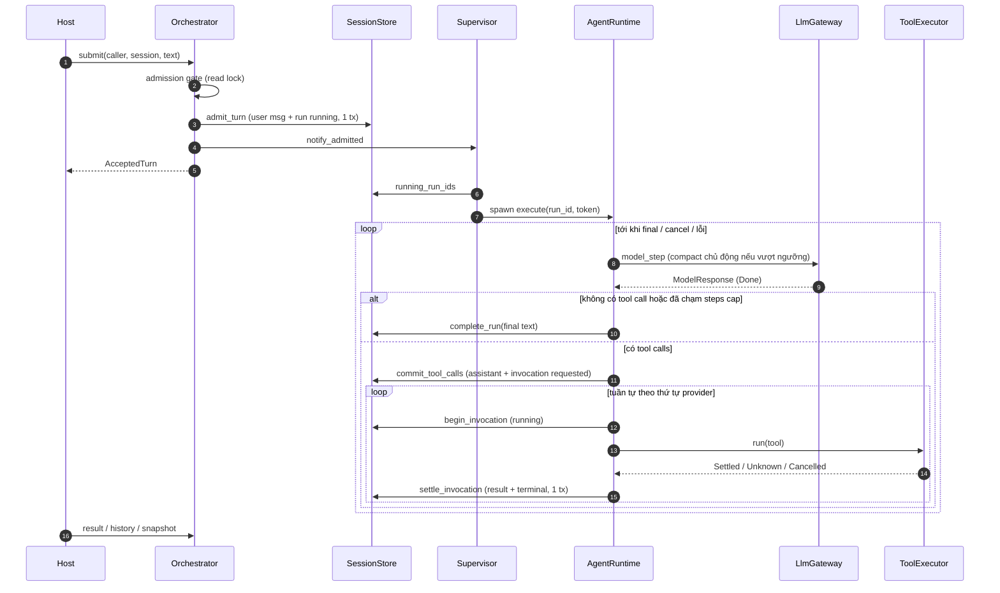
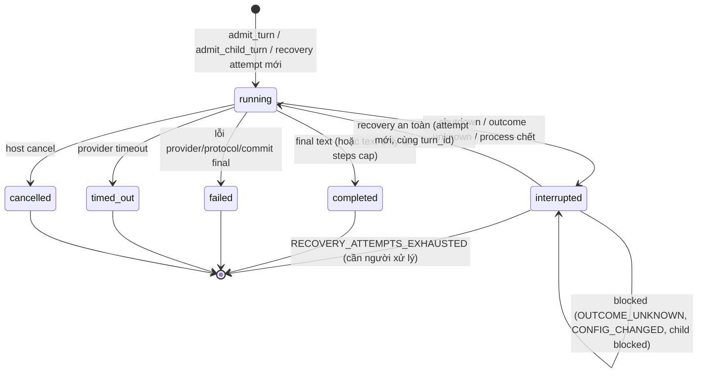

# Đánh giá flow của Orchestrator (baseline M0–M7)

> Phạm vi: flow thực thi trong code hiện tại — build → admission → supervisor → `AgentRuntime` →
> tool/subagent → terminal → recovery/cancel/shutdown → observation. Đối chiếu với
> `docs/11-flows.md`, `docs/15`, `docs/18` và các ADR-008/009/010/011/012/013.
>
> Chứng cứ: đọc mã nguồn tại commit `89a5bf0`; `cargo test --features test-support` pass toàn bộ
> (live-provider test bị `#[ignore]`, không chạy). Các finding dưới đây là phân tích tĩnh, **chưa**
> có test tái hiện trừ khi ghi rõ.

## 1. Tóm tắt

Flow lõi **đúng hướng và chặt về tính bền vững**: admission bền trước khi trả `Accepted`, một
transcript writer duy nhất, commit trước side effect, không bao giờ replay mù tool `Mutating`,
recovery bounded và shutdown nhiều pha có owner lock. Các bất biến của ADR-009/010/013 được giữ
nhất quán trong code.

Điểm yếu chủ yếu nằm ở **vận hành khi tải cao hoặc khi store lỗi kéo dài**: không có backoff khi
worker không commit được (có thể gọi lại LLM lặp lại), không giới hạn concurrency toàn cục, và một
vài khe ngữ nghĩa giữa nhánh "lỗi trong process" với nhánh "crash rồi restart" của delegation.

| Mức | Số finding | Chủ đề |
|---|---|---|
| P1 | 1 | Vòng lặp re-execute không backoff khi store ghi lỗi |
| P2 | 3 | Concurrency không giới hạn; child mồ côi sau operator resolve; giới hạn context/timeout toàn cục |
| P3 | 6 | Compaction input không chặn tổng; poll child; đọc DB thêm mỗi event; cancel semantics; idempotency `submit`; kiểu trả về `bool` |

## 2. Bản đồ flow hiện tại

### 2.1. Thành phần và trách nhiệm

| Thành phần | Trách nhiệm trong flow | Nguồn |
|---|---|---|
| `OrchestratorBuilder::build` | Validate config/registry/skills, snapshot prompt, lấy owner lock, mở SQLite, sweep artifact mồ côi, đánh dấu run cũ `interrupted`, startup recovery, nối runtime, start supervisor | [builder.rs](../../src/orchestrator/builder.rs#L86-L325) |
| `Orchestrator` (facade) | `submit`/`result`/`history`/`cancel`/`archive`/`subscribe`/`snapshot`/`resolve_interrupted_invocation`/`shutdown` | [session.rs](../../src/orchestrator/session.rs), [lifecycle.rs](../../src/orchestrator/lifecycle.rs) |
| `Supervisor` | Spawn đúng một worker cho mỗi claim `running` chưa có owner (sau admission, khi worker xong, sweep định kỳ); cancel từng run; shutdown | [supervisor.rs](../../src/supervisor.rs#L207-L289) |
| `AgentRuntime` | Runner + transcript writer duy nhất: vòng model ⇄ tool, steps cap, compaction, terminal | [runtime/mod.rs](../../src/runtime/mod.rs#L124-L275) |
| `ToolExecutor` | Validate schema/permission, chạy HostTool/skill/artifact_read/subagent với timeout + cancel hợp tác; không ghi transcript | [executor/dispatch.rs](../../src/executor/dispatch.rs) |
| `TaskManager` | Admit child turn idempotent theo `invocation_id`, chờ kết quả child, map thành `ToolOutcome` | [subagent/manager.rs](../../src/subagent/manager.rs#L81-L204) |
| `SessionStore` | Mọi transaction: admission, invocation, settle, terminal, recovery, snapshot | [store/](../../src/store) |
| `Emitter`/`ExecutionFeed` | Publish committed event sau commit (kèm revision) và ephemeral delta | [feed/emitter.rs](../../src/feed/emitter.rs) |

### 2.2. Happy path: submit → final

### 2.3. Máy trạng thái run

### 2.4. Các nhánh phụ

- **Delegation (foreground, depth 1):** tool `subagent` → `admit_child_turn(invocation_id, …)`
  idempotent → supervisor spawn child worker → parent poll `load_result` (10 ms → 250 ms) → map
  terminal của child thành `ToolOutcome`/`ToolError`. `subagent` được coi là replay-safe nhờ admit
  idempotent theo `invocation_id`.
- **Cancel:** `active_run_family` trả parent trước child; có worker thì cancel token, chưa có thì
  ghi `cancelled` trực tiếp rồi cancel lần nữa để bắt worker vừa spawn
  ([session.rs](../../src/orchestrator/session.rs#L155-L182)).
- **Startup recovery:** dưới owner lock → `mark_stale_runs_interrupted` → `recover_all` (child
  trước parent) → chỉ tạo attempt mới khi mọi invocation chưa settle là `requested` hoặc
  replay-safe, child không bị chặn và routing identity không đổi
  ([recovery.rs](../../src/store/recovery.rs#L284-L440)).
- **Operator reconciliation:** ghi kết quả đã xác minh + audit trong một transaction, rồi
  `recover_after_resolution` đi từ session lên các parent.
- **Shutdown:** đóng admission (write lock) → drain có hạn → cancel → spawn nốt claim chưa có
  owner để chúng bị `interrupted` đúng cách → join trong `grace` → đóng store → nhả lock; quá hạn
  thì trả lỗi và **giữ** lock ([supervisor.rs](../../src/supervisor.rs#L160-L195)).

## 3. Điểm mạnh

1. **Accepted = durable.** Input + claim commit trong một transaction; partial unique index
   chặn hai run `running` trên một session (test: 16 submit song song → đúng 1 claim).
2. **Một transcript writer.** Executor/TaskManager chỉ trả outcome; mọi ghi history nằm trong
   `AgentRuntime` + `SessionStore` (ADR-009). Dễ suy luận về thứ tự ghi.
3. **Commit trước side effect, settle trong một transaction.** `begin_invocation` (running)
   trước khi gọi tool; result + terminal state commit chung. Response lỗi/cụt không tạo
   invocation nào (AT-35).
4. **Không replay mù.** Tool `Mutating` timeout/panic → `Unknown` → run `interrupted` với
   `TOOL_OUTCOME_UNKNOWN`; chỉ operator gỡ được. ReadOnly/skill/subagent được replay an toàn.
5. **Supervisor tự chữa lành khe commit→spawn.** `Notify` giữ permit, sweep định kỳ cứu trigger
   bị mất; spawn trong lúc giữ mutex nên không có worker trùng cho một `run_id`.
6. **Shutdown đúng nghĩa.** Phân biệt `cancelled` (host) với `interrupted/SHUTTING_DOWN`
   (phục hồi được); không nhả owner lock khi còn task có thể ghi.
7. **Recovery bounded và có điều kiện.** `resume_attempt` có trần; đổi provider/model/fingerprint
   thì chặn thay vì chạy tiếp với model khác.
8. **Observation không phá correctness.** Committed event chỉ phát sau commit và chỉ là tín hiệu
   invalidate; client lấy snapshot canonical trong một read transaction.
9. **Test phủ theo milestone** (m0–m7, fault hooks cho drop trigger/feed/artifact) và đều pass.

## 4. Findings

### FLOW-01 · P1 · Re-execute không backoff khi store ghi lỗi, có thể gọi lại LLM lặp vô hạn

**Hiện trạng.** Khi không commit được, `execute` trả `false`, worker rời `owned` nhưng run vẫn
`running`; sweep kế tiếp (mặc định 30 s) spawn lại. Nhánh
[`commit_tool_calls` lỗi](../../src/runtime/mod.rs#L244-L252)
được chú thích "sweep gọi lại LLM, an toàn" — an toàn về **correctness** nhưng không về chi phí.
Nếu đọc vẫn được còn ghi thất bại kéo dài (đĩa đầy, file DB read-only, lock giữ lâu hơn
`busy_timeout` 5 s), mỗi chu kỳ sweep sẽ gọi provider một lần, không có bộ đếm hay trần trong
process (`max_resume_attempts` chỉ áp cho recovery sau restart).

**Rủi ro.** Đốt token/quota không giới hạn; log nhiễu; host không thấy trạng thái lỗi (run vẫn
`running`).

**Đề xuất.**
- Supervisor giữ bộ đếm `consecutive_unsettled` theo `run_id` (in-memory) với backoff mũ.
- Quá N lần: thử `finish_run_without_final(Interrupted, "STORE_UNAVAILABLE")` (recoverable sau
  restart), nếu vẫn không ghi được thì ngừng spawn run đó tới khi store khỏe lại.
- Phát ephemeral event/metric để host phát hiện.
- Test: fault hook làm `commit_tool_calls` lỗi liên tục, khẳng định số lần gọi gateway bị chặn.

### FLOW-02 · P2 · Không giới hạn số run chạy đồng thời

**Hiện trạng.** [`spawn_unowned`](../../src/supervisor.rs#L250-L289)
spawn worker cho **mọi** claim `running`. Không có semaphore toàn cục hay theo provider;
`docs/08` chỉ ghi "global child semaphore thêm khi triển khai concurrent children", nhưng nhiều
root session song song đã đủ gây burst.

**Rủi ro.** Nhiều request đồng thời tới provider → 429/timeout → run `failed`/`timed_out` hàng
loạt; pool SQLite 5 connection bị tranh chấp bởi worker + poll child + emitter.

**Đề xuất.** Thêm `RuntimeConfig::max_concurrent_runs` (tùy chọn, mặc định không giới hạn để giữ
hành vi). Claim vẫn durable và chờ slot; worker child không được bị chặn bởi slot của parent
đang chờ nó (tránh deadlock) — ví dụ cấp slot riêng cho child hoặc cho parent nhả slot khi đang
`await_child`.

### FLOW-03 · P2 · Child "mồ côi" sau khi operator resolve, lệch ngữ nghĩa với nhánh restart

**Hiện trạng.** Hai nhánh xử lý cùng một sự cố (child bị `TOOL_OUTCOME_UNKNOWN`) cho kết quả khác:

| Nhánh | Parent | Child sau khi operator resolve |
|---|---|---|
| Crash → restart | Parent cũng `interrupted`, recovery bị chặn `RECOVERY_BLOCKED` chờ child | Child resume, rồi parent resume và nhận kết quả child — nhất quán |
| Lỗi trong process | [`await_child`](../../src/subagent/manager.rs#L158-L204) thấy child terminal `interrupted` → `CHILD_FAILED`; parent tiếp tục và có thể đã `completed` | [`recover_after_resolution`](../../src/store/recovery.rs#L152-L181) vẫn resume child vì candidate filter không xét parent invocation đã settle |

Kết quả: child chạy tiếp tốn token mà không ai tiêu thụ output; nếu model của parent sau đó
gọi `subagent` với `session_id` đó, có thể nhận `SESSION_BUSY`.

**Đề xuất (chọn một, cần quyết định domain).**
- (a) Khi child bị `interrupted` trong process và parent đang chờ, parent cũng chuyển
  `interrupted/RECOVERY_BLOCKED` thay vì nhận `CHILD_FAILED` — đồng nhất với nhánh restart.
- (b) Giữ `CHILD_FAILED`, nhưng `recover_run` của child bỏ qua khi parent invocation liên kết đã
  settle (child chỉ resume khi parent hoặc host chủ động gửi turn mới).

Phương án (a) ảnh hưởng ADR-002 (Root tự đánh giá kết quả child) và ADR-013; cần ghi ADR nếu chọn.

### FLOW-04 · P2 · `context_limit_tokens` và `tool_timeout` là toàn cục

**Hiện trạng.** `ContextPolicy` và `ToolLimits` lấy từ `RuntimeConfig` dùng chung cho mọi agent
và mọi tool ([config.rs](../../src/config.rs#L128-L145):
100 000 token, 300 s). Root và Child được phép dùng provider/model khác nhau, context window
thật có thể chênh nhiều lần; tool kiểu tải/transcribe video (xem `examples/video_summary.rs`)
cần timeout khác tool đọc nhanh.

**Rủi ro.** Model window nhỏ: phụ thuộc vào nhánh overflow-retry (chỉ một lần) → dễ `failed`.
Model window lớn: compact sớm, mất ngữ cảnh không cần thiết. Tool dài: `Mutating` timeout →
`TOOL_OUTCOME_UNKNOWN` → cần operator.

**Đề xuất.** Override tùy chọn `AgentDefinition::context_limit_tokens` và
`ToolDescriptor::timeout`, fallback về giá trị toàn cục.

### FLOW-05 · P3 · Input của compaction không chặn tổng

[`compaction::plan`](../../src/compaction.rs#L85-L141)
cắt từng item theo `SUMMARY_INPUT_ITEM_BYTES` nhưng không chặn tổng prefix. Ước lượng token là
`bytes / BYTES_PER_TOKEN`, nên với model window nhỏ hoặc history có rất nhiều item ngắn, chính
request tóm tắt có thể overflow → run `failed` với `CONTEXT_OVERFLOW`. Đề xuất: chặn tổng input
theo `limit_tokens` và tóm tắt cuốn chiếu (chunked/rolling) dựa trên `previous_summary` sẵn có.

### FLOW-06 · P3 · Parent chờ child bằng polling

`await_child` đọc SQLite theo chu kỳ 10 → 250 ms. Đúng và đơn giản, nhưng thêm độ trễ tới 250 ms
cho mỗi delegation và tạo tải đọc tỉ lệ với số delegation đồng thời. Đề xuất: `watch`/`Notify`
theo `run_id` báo từ nhánh terminal của runtime, giữ polling chậm làm fallback (giống mô hình
trigger + sweep của supervisor).

### FLOW-07 · P3 · Mỗi committed event đọc thêm DB một lần

[`Emitter::committed_run`](../../src/feed/emitter.rs#L38-L42)
query `event_info_for_run` sau commit để lấy root/revision; một step có tool sinh nhiều event
(message, tool.started × N, tool.completed × N). Đề xuất: các hàm store trả về
`(root_session_id, revision)` từ chính transaction (`RETURNING state_revision`) để emitter khỏi
đọc lại.

### FLOW-08 · P3 · Ngữ nghĩa cancel cần ghi rõ

- Tool `Mutating` không kiểm tra cờ `cancelled` sẽ chạy tới `tool_timeout` (300 s) và run kết
  thúc `interrupted/TOOL_OUTCOME_UNKNOWN` chứ không phải `cancelled`
  ([dispatch.rs](../../src/executor/dispatch.rs#L91-L175)).
  Hành vi này đúng về an toàn nhưng host dễ bất ngờ: cần ghi vào doc của `cancel` và `HostTool`.
- `cancel` dùng `ensure_open` nên bị từ chối khi đang drain shutdown; với `shutdown_drain > 0`,
  host không thể hủy run đang drain. Cân nhắc cho phép `cancel` trong pha drain.

### FLOW-09 · P3 · `submit` không có idempotency key

Host retry sau timeout transport có thể tạo turn trùng (nếu turn đầu đã xong) hoặc nhận
`SESSION_BUSY` khó phân biệt với "đã nhận". Đề xuất: `client_request_id` tùy chọn, unique theo
session, trả lại `AcceptedTurn` cũ khi trùng.

### FLOW-10 · P3 · Kiểu trả về `bool` của `execute`/`Flow::Stop(bool)` mang hai nghĩa

`true` = "đã terminal (hoặc vốn terminal)", `false` = "không commit được, để sweep". Nghĩa được
mã hóa trong comment, lặp lại ở nhiều nhánh `Err(_) => return false`. Một enum
`Settlement { Terminal, Unsettled }` giúp đọc flow rõ hơn và là chỗ tự nhiên để gắn lý do cho
FLOW-01.

## 5. Trade-off có chủ đích (không phải lỗi)

| Quyết định | Hệ quả chấp nhận | ADR |
|---|---|---|
| Tool chạy tuần tự theo thứ tự provider | Không song song tool/child trong một step; throughput thấp hơn, đổi lấy pairing và recovery đơn giản | ADR-009/010 |
| Foreground delegation, depth 1 | Parent giữ worker trong lúc chờ child; không fan-out song song | ADR-008 |
| Không step cap mặc định | Run dài phụ thuộc compaction và cancel của host | ADR-011 |
| Không exactly-once với side effect ngoài | Cần operator reconcile khi outcome unknown | ADR-010/013 |

## 6. Thứ tự xử lý đề nghị

1. **FLOW-01** — rủi ro chi phí trực tiếp, sửa cục bộ trong supervisor + runtime; kèm FLOW-10
   nếu muốn refactor kiểu trả về cùng lúc.
2. **FLOW-03** — cần chốt ngữ nghĩa (a) hay (b) qua domain-modeling/ADR trước khi code.
3. **FLOW-02, FLOW-04** — cần trước khi chạy nhiều session/production với nhiều provider.
4. **FLOW-05 … FLOW-09** — cải thiện khi có số đo hoặc nhu cầu tích hợp cụ thể.

## 7. Kết quả xử lý (2026-10-20)

Làm theo TDD: mỗi finding có test đỏ tái hiện qua public `Orchestrator` + `ScriptedGateway`
trước khi sửa.

| Finding | Thay đổi | Test |
|---|---|---|
| FLOW-01 | Supervisor giữ backoff theo `run_id` (mũ theo `supervisor_sweep`, trần ×16). Sau 5 lần `Unsettled` liên tiếp, `AgentRuntime::give_up` chuyển run sang `interrupted/STORE_UNAVAILABLE`. Mã này nằm trong `RECOVERABLE_CODES`, nên lần khởi động sau sẽ phục hồi run | `unsettled_run_backs_off_and_stops_calling_the_model_when_writes_keep_failing`. Trước khi sửa: 50 lần gọi model trong 0,5 s |
| FLOW-10 | `execute`/`Flow::Stop`/`settle_one`/`model_step`/`fail`/`finish` trả `Settlement { Terminal, Unsettled }` thay cho `bool` | Toàn bộ suite |
| FLOW-03 (b) | `recover_run_inner`: khi child turn sắp được resume mà tool call `subagent` của parent đã có kết quả cuối, run được đánh dấu `DELEGATION_CLOSED` và không resume. Mã này không chặn admission, nên Root vẫn tiếp tục child bằng `session_id` | `resolving_a_child_the_parent_already_gave_up_on_does_not_resume_it`. Trước khi sửa: có thêm một lần gọi model cho child mồ côi |
| FLOW-04 | `AgentDefinition::with_context_limit_tokens` (field `context_limit_tokens: Option<usize>`) và `HostTool::timeout()` (mặc định `None`). Giá trị `0` bị từ chối lúc build | 4 test mới trong `m4_continuous.rs` |
| FLOW-02 | `RuntimeConfig::max_concurrent_root_runs: Option<usize>` (mặc định `None`). Claim vượt mức vẫn durable và chờ slot theo thứ tự admission. Child không bị tính vào giới hạn (depth 1, tool tuần tự), nên parent đang chờ child không bị deadlock. Shutdown bỏ qua giới hạn và backoff | 3 test mới trong `m5_recovery.rs` |

> [!NOTE]
> `AgentDefinition` có thêm một field `pub`. Host nào dựng struct này bằng struct literal sẽ
> phải thêm field đó; trong repo chỉ dùng `AgentDefinition::new`. Các hành vi mặc định không đổi.

FLOW-05…09 chưa xử lý.

## 8. Giới hạn của đánh giá

- Không chạy live-provider test, không đo tải, không fault-injection ổ đĩa đầy.
- FLOW-01 và FLOW-03 suy ra từ đọc code; nên viết test tái hiện (fake gateway đếm số call;
  child `Mutating` timeout trong process + `resolve_interrupted_invocation`) trước khi sửa.

